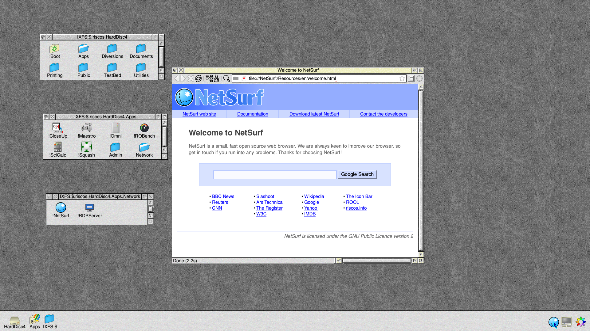

# RISC OS on Linux

RISC OS 5 on 64-bit ARM machines, running on a small Debian 13 Linux that
starts straight into the RISC OS desktop. One card image works on a
Raspberry Pi 3, 4, 5 or Zero 2 W, a Pinebook or Pinebook Pro, and other
UEFI machines. A ready-made virtual machine covers Apple Silicon Macs (UTM),
and there is a separate image for the Windows Dev Kit 2023.

Where the processor can run 32-bit ARM programs (every Raspberry Pi above,
the Pinebooks, the Dev Kit) RISC OS runs natively, at full speed. Elsewhere
(an Apple Silicon Mac, most ARM servers) it runs under QEMU.

This is a **test release**: it runs well on the machines below, but please
[report anything that doesn't work](#reporting-a-problem).

## Download

Get the images from **[Releases](../../releases)**. The newest is
[1.0.0018](releases/1.0.0018.md).

| Image | For | File |
|---|---|---|
| Generic | Raspberry Pi 3/3B+/CM3, Zero 2 W, 4/400/CM4, 5/500/CM5; Pinebook and Pinebook Pro; UEFI machines (QEMU, ARM boards and servers) | `riscos-generic.img.xz` |
| UTM | Apple Silicon Macs | `RISC OS 1.0.0018.utm.zip` |
| Windows Dev Kit 2023 | Snapdragon 8cx Gen 3 ("Project Volterra") only | `riscos-wdk2023.img.xz` |

`SHA256SUMS` in each release lists the files' checksums.

## Installing

- [Raspberry Pi](docs/install-raspberry-pi.md)
- [Apple Silicon Mac (UTM)](docs/install-utm-mac.md)
- [Windows Dev Kit 2023](docs/install-dev-kit-2023.md)
- [Pinebook, Pinebook Pro and other UEFI machines](docs/install-uefi-and-pinebook.md)

In short: write the `.img.xz` to a card or USB stick of 4 GB or more with
[Raspberry Pi Imager](https://www.raspberrypi.com/software/) ("Use custom")
or [balenaEtcher](https://etcher.balena.io), and start the machine from it.
On a Mac, unzip the `.utm` and double-click it.

## Using it

[Using RISC OS on Linux](docs/using.md) covers:
- the screen, sound and network;
- USB discs and SD cards;
- the `*Linux` command and the root password;
- shutting down.

## Keeping it up to date

**Configure → Updates** keeps everything up to date without reinstalling:
RISC OS itself, its Linux side, the kernel and Debian's security fixes. You
can also roll RISC OS back to the build before. See
[Updates and going back](docs/updates-and-rollback.md); what each update
changed is listed in Updates' **Changes** window.

## If something goes wrong

[Troubleshooting](docs/troubleshooting.md) covers:
- a dark screen, and the start-up logs every machine writes to its card;
- a new RISC OS or kernel that won't start;
- a forgotten root password;
- UTM machines that stopped starting after the 4 November update.

## Reporting a problem

Open an [issue](../../issues/new/choose). Please include:
- the machine;
- the image build;
- the versions Configure → Updates shows;
- what happened;
- the logs from the card's `LOGS` folder, if the problem is at start-up.

## Known issues

- The Filer can stop with an abort in the kernel's sprite plotting when
  opening certain directories (seen with !RiscOSM's).
- On a Raspberry Pi, ROBench's BPut/BGet tests fail to open their file.
- Discs inside the machine in RISC OS's own format (FileCore on an internal
  SSD or NVMe) aren't offered to RISC OS. USB discs and SD cards are.
- Socket_Connect can report success for a connection that was refused.
- Iris isn't included. Get it from riscosdev.com or PackMan. Iris 1.039
  needs `riscos-support` 1.0.0031-1 or later, from Configure → Updates; with
  older versions, bbc.co.uk and other script-heavy pages stop half-drawn.

## Where it comes from

- **RISC OS itself** is RISC OS Open's, in Timothy Baldwin's
  [Linux port](https://github.com/TimothyEBaldwin/RISC_OS_Linux_Source).
- **The images' own parts and how they're built:**
  [riscos-linux](https://github.com/adyoull/riscos-linux).
- **The packages Updates installs:**
  [riscos-rolpkg](https://github.com/adyoull/riscos-rolpkg).
- **Licences:** each image has its licences and where to get the sources in
  `LICENCES` and `SOURCE.txt` on its FAT partition, and in
  HardDisc4.Documents.

Thank you to **Chris Gransden** for testing and reports.

Copyright (c) 2026 Andrew Youll. These documents: MIT licence (see LICENSE).
