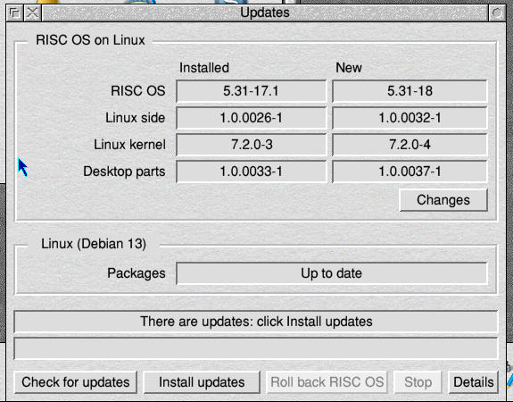
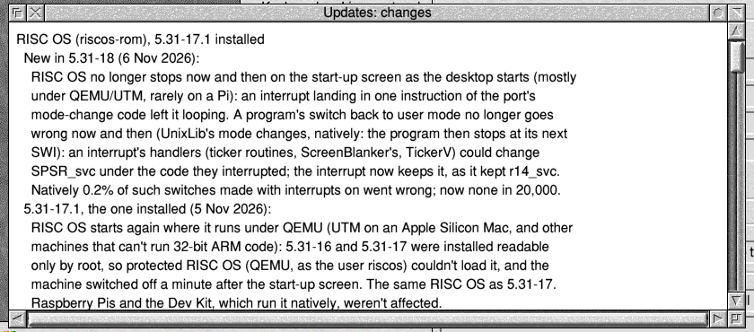
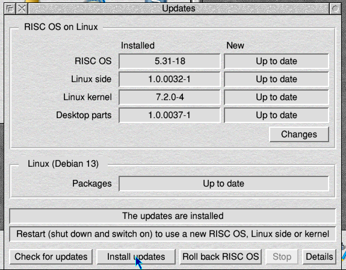

# Updates and going back

**Configure → Updates** (or HardDisc4.Utilities.!Updates) keeps the whole
machine up to date:

| Package | What it is |
|---|---|
| `riscos-rom` | RISC OS itself (the ROM) |
| `riscos-support` | the Linux side: start-up, screen, keyboard, sound, network, USB, and NativeSupport (which lets RISC OS run natively) |
| `riscos-harddisc` | RISC OS on Linux's own desktop parts in HardDisc4: Updates, Configure's Linux network, the hard disc icon, `*Linux`, USBDriver and others. Your own files and choices are never touched |
| `riscos-kernel-*` | the Linux kernel this machine starts (Pi, generic or Dev Kit) |
| Debian's packages | Linux itself, with its security fixes |



## Updating

1. **Check for updates** shows what's new. **Changes** shows what each new
   version changed.

   
2. **Install updates** installs them. It asks for the root password: see
   [Using](using.md#linux-commands-from-risc-os-linux-and-the-root-password).
3. Shut down and switch on again to use them.

   

From the command line: `*Linux apt-get update` then
`*Linux apt-get full-upgrade`.

## Going back

- **Roll back RISC OS** (in Updates) installs the RISC OS build before the
  one you have. The repository keeps the last two versions of each package.
- **A new RISC OS that won't start:** put the card in any computer and
  make an empty file called `ROLLBACK` on its small FAT partition. The next
  start puts back the RISC OS that was replaced.
- **A new kernel that won't start:** the old one is kept on the FAT partition
  as `*.old`. Rename it back, for example:
  - `EFI/BOOT/BOOTAA64.EFI.old` → `EFI/BOOT/BOOTAA64.EFI`;
  - `kernel8.img.old` → `kernel8.img` on a Pi.

## Only the kernel this machine starts

The generic card holds two kernels, the Pi's and the UEFI one, so it starts
on both. Updates keeps only the one this machine starts up to date, and
leaves the other as it is.

## The package repository

The images already have it set up:

```
deb https://adyoull.github.io/riscos-rolpkg/ rol main
```

The key's fingerprint is `C7CC 988D 25FD FAF8 00E0  AD6E 019A FF73 7974 A1C3`.
The full history of changes is in
[riscos-rolpkg's CHANGELOG](https://github.com/adyoull/riscos-rolpkg/blob/main/CHANGELOG.md).
