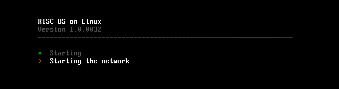
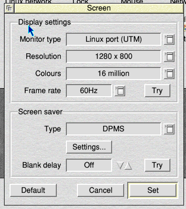
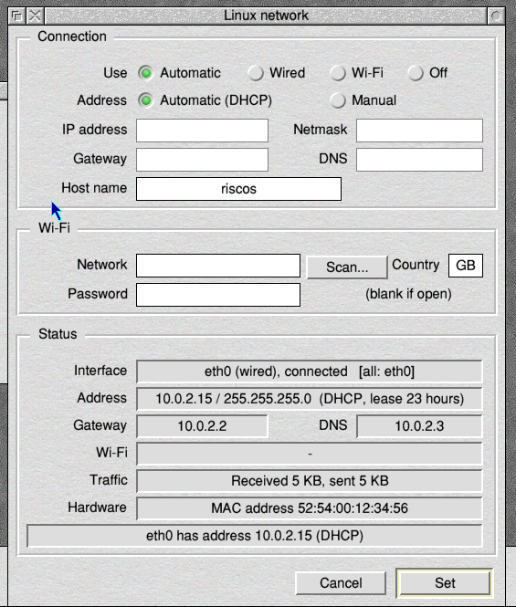
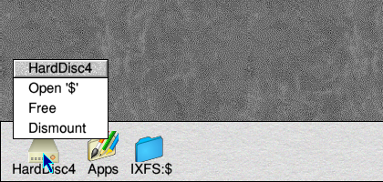
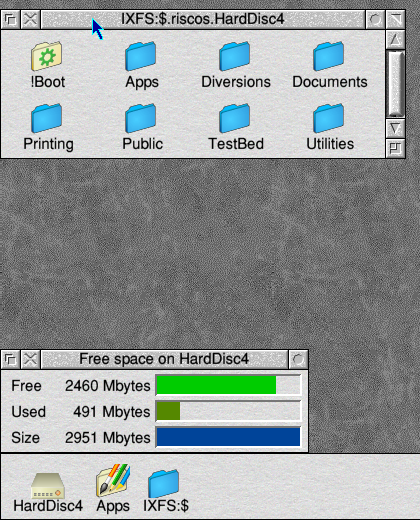
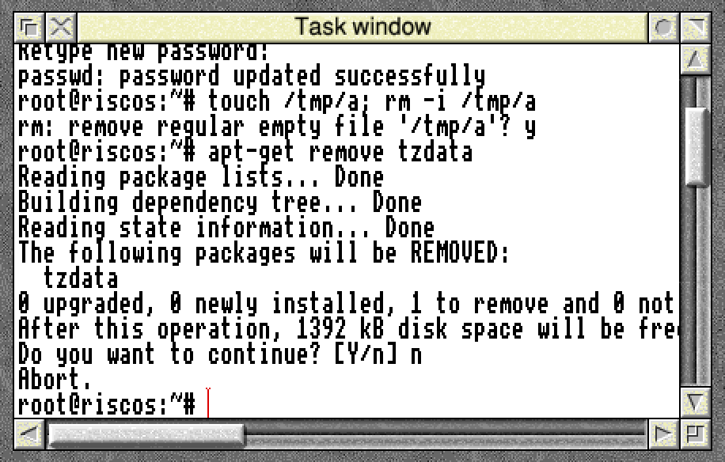
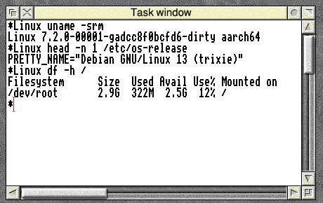
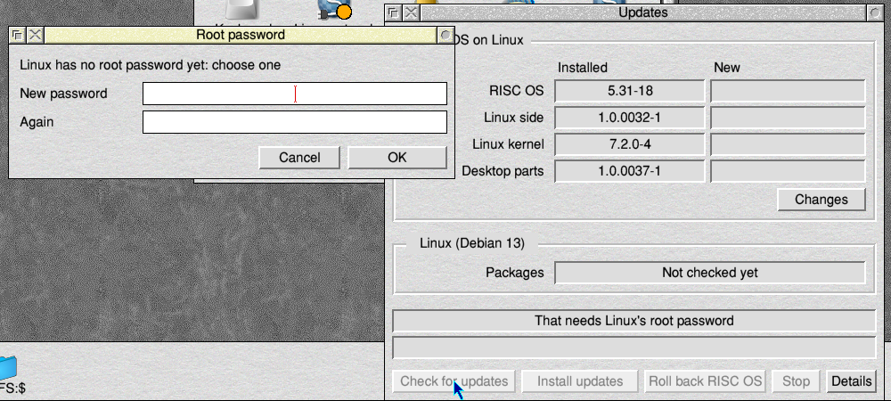
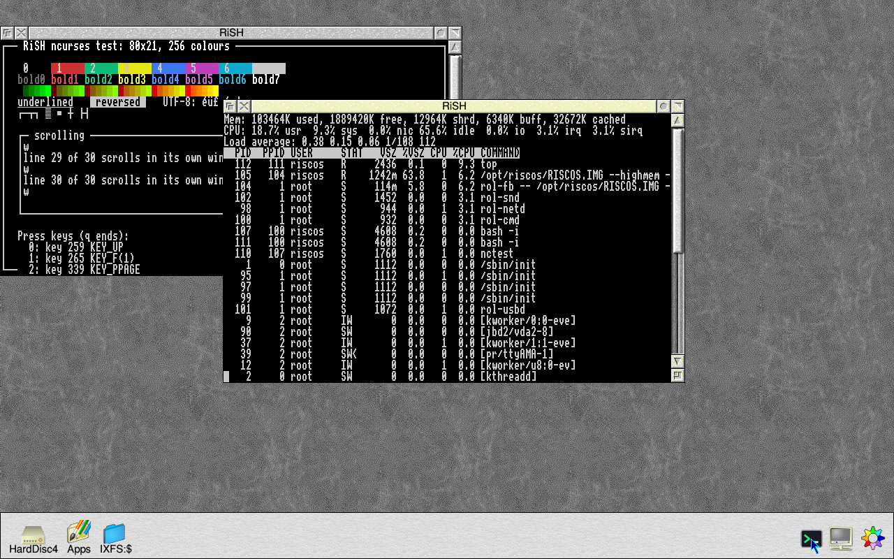
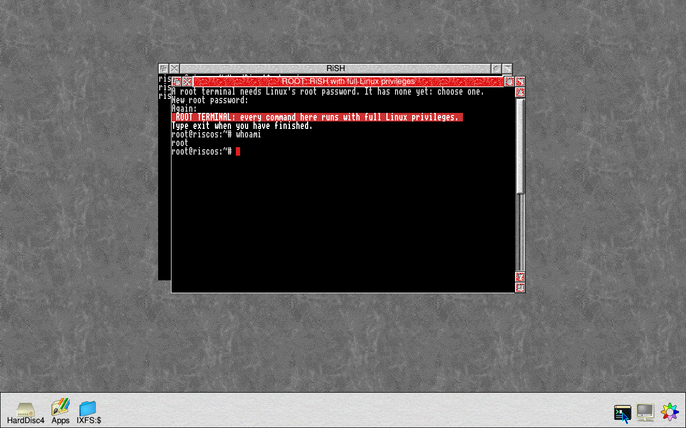

# Using RISC OS on Linux

## Starting and shutting down

- **Starting:** the machine starts straight into the RISC OS desktop. A start-up screen says what's happening: the disc being enlarged on the first start, the network, the clock, RISC OS starting.

  
- **Shutting down:** Shutdown (the Task manager's menu, or Ctrl-Shift-F12) powers the machine off.

## Screen

- **The mode at start-up:** the desktop starts at the screen's own size, in 16 million colours. Very large screens are halved to fit RISC OS's 16 MB screen.
- **Choosing a mode:** pick another in Configure → Screen and click Set. That one is used at every start.
- **In a virtual machine:** resizing the window changes the mode to fit, for that session.

## Mouse and keyboard

- **The buttons:** left is Select, middle is Menu, right is Adjust.
- **The wheel** scrolls the window under the pointer. Configure → Scroll wheel turns it round (reversed, as on a Mac).
- **USB:** keyboards and mice are USB.

## Sound

RISC OS's own sound modules play through Linux:
- HDMI, if the screen takes sound;
- otherwise the Pi's headphone socket;
- a USB sound card comes first when one is plugged in.

Set the volume in Configure → Sound, or with `*MixVolume`.

## Network

- **Wired:** wired Ethernet with DHCP works as it comes.
- **Wi-Fi, or a fixed address:** set them in Configure → **Linux network**.
- **Where the settings are kept:** in plain text in `/riscos/net/config` on the Linux partition, including the Wi-Fi password.
- **A network that comes up late:** PackMan, NetSurf and the rest still work. RISC OS's name servers follow Linux's.

## The time

Linux sets the clock from the internet as soon as the network is up, and
every hour after. A Pi has no clock battery, so the time is also kept on the
card and put back at the next start.

## Discs

- **HardDisc4** is on the icon bar as a hard disc icon:
  - Select opens it;
  - Menu has Open '$', Free and Dismount.
- **USB discs and SD cards:**
  - **Plugging one in:** its icon appears on the icon bar, named by its volume label. FAT, exFAT, NTFS and ext4 all work.
  - **Taking one out:** choose Eject from its menu first, so everything is written.
- **IXFS:$** on the icon bar shows the files RISC OS can see on the Linux side.

## Programs included

- **Apps.Network:** NetSurf (web browser) and RDPServer (remote desktop).
- **Apps.Document:** Folio (PDF and ebook reader).
  - PDF files open in Folio when double-clicked.
  - To use another viewer, delete `!Boot.Choices.Boot.Tasks.FolioPDF`.
- **Installed the PackMan way:** all three are installed as PackMan installs them, so PackMan upgrades them.
- **More from PackMan:** it comes set up, with nothing to add. Open PackMan (Apps.Admin) and install:
  - RISC OS Open's packages (its two lists);
  - riscosdev.com's autobuilt packages, Iris the web browser among them;
  - [riscos-packages](https://github.com/adyoull/riscos-packages): Andrew Youll's apps and ports.

  The certificates its https lists need (!CaCertificates) are installed too.

## Linux commands from RISC OS: `*Linux`, `*IXRun` and the root password

- **Running a Linux command as root:** `*Linux <command>` runs it as root and prints its output; use a task window (Ctrl-F12) for anything long. For example, `*Linux apt-get install htop`.
- **Without root:** `*IXRun <command>` (or `*LinuxUser`) runs it as RISC OS's own Linux user: no password, and it can't change the system. For example, `*IXRun ls -l /riscos/HardDisc4`.
- **Answering a program** (with riscos-harddisc 1.0.0043-1 and riscos-support 1.0.0042-1, from Updates): what you type goes to the Linux program, so one that asks a question or wants a password can be answered.
  - Delete rubs out, the cursor keys recall the shell's earlier lines, and Ctrl-D ends input.
  - **Escape is Ctrl-C.** Escape twice within a second and a half stops the command outright.
- **A shell:** `*IXRun` or `*Linux` with no command starts a Linux shell (root's, for `*Linux`). Type `exit` to come back to RISC OS.
- **Full-screen programs** (nano, vi, top) need RiSH, below: `*Linux` and `*IXRun` are plain, line-by-line terminals.

- **The password:** the first time `*Linux` or Updates runs a command, it asks you to choose a root password.
  - After that it asks for the password, but not again until it has gone unused for five minutes.
  - `*LinuxPassword` changes it.
  - After five wrong tries in a row, wait a minute.
- **Forgotten it?** See [Troubleshooting](troubleshooting.md#forgotten-root-password).

## RiSH, the Linux terminal

RiSH, the RISC Shell (in Apps, with riscos-harddisc 1.0.0048-1 from Updates), is a Linux terminal in a window. Its [release notes](../releases/RiSH-0.03.md) have more pictures.

- **A terminal:** double-click !RiSH. The window is a Linux shell as RISC OS's own Linux user, the one `*IXRun` uses: type Linux commands straight in. `exit`, or closing the window, ends it.
- **A root terminal:** choose **Root shell** from the icon bar icon's menu, or click the icon with Adjust. It asks for Linux's root password first (the one `*Linux` and Updates use). `su` and `sudo` don't work in the ordinary terminal.
  A root terminal is marked so that it can't be mistaken for an ordinary one: a red title bar beginning "ROOT:", a red cursor, and a line in bold at the top.
- **Full-screen programs work:** editors, `top`, `less`, and anything else written for an xterm, in colour. The images have few of them installed: in a root terminal, `apt-get install nano` (or `vim`, `htop`, `less`).
- **The window:** resize it and the program inside is told. The scroll bar shows the last 1000 lines that scrolled off the top. **Large text** on the menu doubles the text size, for 4K screens.
- **Keys:** everything goes to Linux except F12 and the other keys RISC OS keeps. Copy is End.
- **Copy and paste:** drag with Select to select text (Adjust moves the end of the selection). **Copy** on the menu, or Ctrl-Shift-C, puts it on RISC OS's clipboard; **Paste**, Ctrl-Shift-V or Shift-Insert types the clipboard's text in. It works with other RISC OS programs in both directions. Ctrl-C and Ctrl-V alone go to Linux.
- **Not yet:** the mouse inside programs.

## Protected RISC OS

RISC OS runs as an ordinary Linux user, not as root, and sees only its own
files. A RISC OS program can't change Linux or reach the rest of the disc.
`*Linux` and Updates are the deliberate way through, which is why they ask
for the root password.

To run RISC OS as root, with the whole disc, as earlier builds did: on the
Linux partition, change `/etc/riscos/protect` to say `off`. RISC OS itself
can't change that file.

## USB devices for RISC OS programs

Linux drives the USB hardware. The image's USBDriver gives RISC OS programs
RISC OS's own USB interface for the devices Linux has no driver for:
- phones, tablets and cameras in file transfer (MTP/PTP) mode;
- and the like.

`*USBDevices` lists them. PDFS (in HardDisc4.TestBed.PDFS) mounts phones
this way.
