# RISC OS on Linux 1.0.0020 (8 November 2026): the first public release

RISC OS 5.31 (5.31-19: RISC OS Open's nightly in Timothy Baldwin's Linux
port) on Debian 13, for 64-bit ARM machines: Raspberry Pis, UEFI
machines and virtual machines, Apple Silicon Macs (UTM), the Windows
Dev Kit 2023 and the Pinebooks. RISC OS runs straight on the processor
where it can (Raspberry Pi 3, 4 and 5, the Dev Kit, the Pinebooks) and
under QEMU where it can't (Apple's processors).

This is a test release: it runs well on the machines below, but please
[report](../README.md#reporting-a-problem) anything that doesn't work.

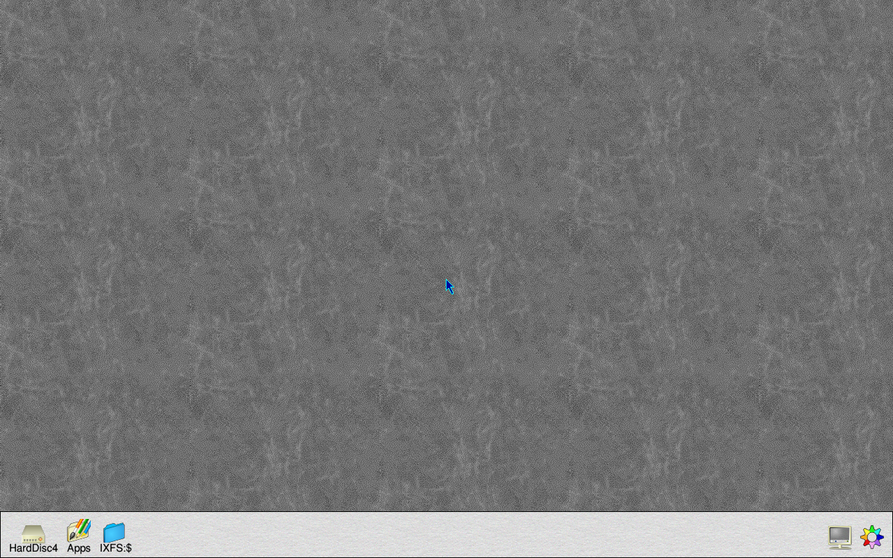

## The images

| Image | For | File |
|---|---|---|
| Generic | Raspberry Pi 3/3B+/CM3, Zero 2 W, 4/400/CM4, 5/500/CM5; UEFI machines (QEMU, ARM boards and servers); Pinebook and Pinebook Pro | `riscos-generic.img.xz` |
| UTM | Apple Silicon Macs | `RISC OS 1.0.0020.utm` (in `RISC OS 1.0.0020.utm.zip`) |
| Windows Dev Kit 2023 | Snapdragon 8cx Gen 3 ("Project Volterra") only | `riscos-wdk2023.img.xz` |

Write the .img.xz to a card or USB disc with Raspberry Pi Imager ("Use
custom") or balenaEtcher. Unzip the .utm and double-click it to add it to
UTM. Each image starts straight into the RISC OS desktop; Shutdown powers
the machine off. `SHA256SUMS` lists the files' checksums. How to install
on each machine is in [the README](../README.md#installing).

The Dev Kit image is only for the Dev Kit: anywhere else Linux finds no
screen and the machine switches off a minute later.

Already running an earlier test build (1.0.0006 or later)? **Configure →
Updates** brings it to the same versions without reinstalling.

## Updates since this release

Configure → Updates → Check for updates installs these on a 1.0.0020
machine. [1.0.0058](1.0.0058.md) is the same system as freshly written
images:

| Date | Package | What changed |
|---|---|---|
| 15 Nov | `riscos-rom` 5.31-30 | **Ovation Pro starts from HardDisc4.** It failed with "Unknown identifier DOTTED at line 52 in <OvationPro$Dir>.Library.!MenuLib" and more, and left an icon with no menu, while from a RAM disc it ran. HardDisc4 handed a folder's files to programs in no order, where RISC OS's own disc formats hand them over alphabetically, and Ovation Pro loads its script files in the order it is given them. Folders are now given in alphabetical order, so `*Cat` is in order too. Not yet run with Ovation Pro itself: reports welcome. |
| 16 Nov | `riscos-harddisc` 1.0.0058-1 | **RISC3D is included**, as a PackMan package (RISC3D 0.04-3 in `!Boot.Resources`): the 3D driver interface that lets programs drawing with OpenGL use the machine's graphics chip. PackMan keeps it up to date from now on. The Linux side that does the drawing is still the separate `riscos-risc3d` package; without it nothing changes. |
| 17 Nov | `riscos-support` 1.0.0071-1 | **Huawei mobile broadband sticks now switch to their network mode.** The message that does it had a byte too many, so sticks stayed CD drives. It is now the same message, sent the same way, as Linux distributions use (usb_modeswitch). Not yet tried with a stick. |
| 17 Nov | `riscos-harddisc` 1.0.0066-1 | **Start-up no longer stops at AArdvarkLoader** (a machine stuck in 640x480, or `*Linux` not found after removing it). A module that wouldn't load on a machine ended the start-up run there, skipping Configure, which sets the screen mode; now each module that fails is passed over and everything else carries on. The loader is now a plain file, `PreDesk.AArdvarkLoader`, which runs first, so Configure's sound settings are applied too. |
| 17 Nov | `riscos-support` 1.0.0072-1 | **RISC OS knows whether the machine's VideoCore can decode video for it** (`ROL$VideoCore`: 1 on a Pi 3 or 4, 0 elsewhere). |
| 17 Nov | `riscos-harddisc` 1.0.0067-1 | **The Pi's hardware video decoding is set up only on a Pi 3 or 4.** A Pi 5 or CM5, which has no H.264 decoder, no longer tries. Needs riscos-support 1.0.0072-1; before that, it is set up as before. |
| 17 Nov | `riscos-harddisc` 1.0.0068-1 | **RiscOSM starts** (it crashed with "Bad memory access"). The images had a cut-down character set converter (Iconv) where RISC OS Open's should be; the update puts RISC OS Open's Iconv 0.12 in its place. Restart afterwards. |
| 17 Nov | `riscos-harddisc` 1.0.0069-1 | **HardDisc4 can no longer be dismounted from its icon** (it is the disc RISC OS runs from); its menu has Open '$' and Free. |
| 17 Nov | `riscos-harddisc` 1.0.0070-1 | **Close windows** on HardDisc4's icon bar menu closes every window on HardDisc4's disc (IXFS), as Dismount does on RISC OS itself. Other discs' windows stay. |
| 17 Nov | `riscos-support` 1.0.0073-1 | **A smooth pointer in UTM and other VMs:** RISC OS's pointer is now the VM display's own cursor, which the host moves at once, instead of being drawn into the picture. |
| 18 Nov | `riscos-kernel-generic` 7.2.0-9 | **The Pinebook Pro's touchpad no longer gets stuck making every click Menu** (a finger the pad stopped reporting was kept as still touching). |
| 18 Nov | `riscos-support` 1.0.0074-1 | **A touchpad's two-finger click or tap is Adjust, three fingers Menu**, as on RISC OS itself on a Pinebook Pro. |
| 18 Nov | `riscos-kernel-wdk2023` 7.2.0-7.2 | **USB sound works on a Dev Kit with a DRAM-less NVMe drive** (the drive had taken all the memory USB sound needed). Restart after updating. |
| 18 Nov | `riscos-support` 1.0.0075-1 | **The sound's logs are in LOGS too**: which card RISC OS's sound plays on, and the sound cards Linux has. |
| 18 Nov | `riscos-support` 1.0.0076-1 | **A USB sound adapter plugged in takes over the sound at once**, and when it's unplugged the sound carries on through the next best output. |
| 18 Nov | `riscos-support` 1.0.0077-1, `riscos-harddisc` 1.0.0071-1 | **A USB disc in RISC OS's format with 4096-byte sectors gets a clear message** instead of SCSIFS's "Sector size not supported" (SCSIFS can't use such discs, on RISC OS itself too). |
| 18 Nov | `riscos-support` 1.0.0078-1 | **No more pause every second in 3D games** (the screen check no longer makes Linux re-read every display connector), and **a steadier pointer** while RISC OS is busy. |
| 18 Nov | `riscos-harddisc` 1.0.0072-1 | **The current directory is HardDisc4 after start-up**, as on RISC OS itself, so programs saving there (crash dumps, for one) work. |
| 18 Nov | `riscos-kernel-pi` 6.6.78-17 | **The Pi 4's, Pi 5's and CM5's HEVC (H.265) decoder is there for RISC OS** (Linux's rpivid driver, as `/dev/video*` and `/dev/media*`): the first step to hardware HEVC in ReelHWAccel under ROL. ReelHWAccel still needs a back end that uses it, so nothing plays HEVC through it yet. Not yet tried on a Pi 4 or 5. |
| 19 Nov | `riscos-kernel-pi` 6.6.78-18 | **HEVC frames can be cacheable**, so ReelHWAccel's HEVC decoder can convert pictures as fast as on native RISC OS (it was 3 to 4 times slower with uncached frames). Needs hevcdec 0.1.16. Not yet tried on a Pi 4 or 5. |
| 19 Nov | `riscos-support` 1.0.0079-1 | **PackMan comes back if it's missing**: when there's no !PackMan anywhere in HardDisc4, PackMan 0.9.8-1 is put back in Apps.Admin with its record, so it can upgrade itself as usual. One that has been moved is left alone. |
| 19 Nov | `riscos-support` 1.0.0080-1 | **The boot partition is checked and repaired at start-up**, so a machine switched off without shutting down no longer leaves updates failing with "Read-only file system". Brings in Debian's dosfstools. |
| 19 Nov | `riscos-kernel-generic` 7.2.0-10 | **Pinebook Pro Wi-Fi:** Linux now does the WPA2 handshake instead of the Wi-Fi chip's firmware, the usual workaround for its WPA2 problems. Not yet tried on a Pinebook Pro. |
| 20 Nov | `riscos-support` 1.0.0081-1 | **A smooth pointer in UTM while a program keeps RISC OS busy** (it went jerky with NetSurf running): in a VM with an absolute pointer, a mouse's moves now place the pointer at once rather than by way of RISC OS. Real mice on real machines are unchanged. Not yet tried in UTM. |
| 22 Nov | `riscos-support` 1.0.0082-1, `riscos-kernel-pi` 6.6.78-18.1, `riscos-kernel-generic` 7.2.0-10.1 | **Kernel updates no longer fill the boot partition** ("No space left on device"): one old copy of each kernel is kept, and the new one is swapped in by renaming. The kernel packages are repackaged to need this support version. |
| 24 Nov | `riscos-kernel-pi` 6.6.78-18.2, `riscos-kernel-generic` 7.2.0-10.2, `riscos-kernel-wdk2023` 7.2.0-7.3 | **The running kernel keeps its drivers if a kernel update doesn't reach the boot partition**: its modules are kept until the machine restarts with the new kernel (a failed update had left the old kernel running without them, so drivers such as the Argon ONE UP's battery were lost). Repackaged, same files. |
| 24 Nov | `riscos-support` 1.0.0084-1 | **Sound from a Raspberry Pi's HDMI screen**: on a Pi, sound always went to the headphone socket, even with a screen with speakers. It now goes to the screen when the screen takes sound. To choose yourself, put `device=vc4hdmi0` (or `vc4hdmi1`, or `Headphones`) in `/riscos/sound/config`. Heard on a Pi 4 with the setting; the automatic choice is not yet tried on a Pi. |
| 24 Nov | `riscos-support` 1.0.0083-1 | The sound log now says how loud RISC OS's sound is and how the output's volume is set, to find where sound is lost. |
| 24 Nov | `riscos-rom` 5.31-31 | **Faster network downloads, over Ethernet and Wi-Fi.** Most RISC OS network programs set their own buffer sizes, and on Linux that held a download to a fraction of the line's speed (on a Pi 4 over Ethernet, 14 Mbit/s with 32 KB where Linux gets 160; Iris got 11). RISC OS now keeps those sizes for the program and lets Linux size the buffers. |
| 25 Nov | `riscos-rom` 5.31-32 | **Ping works, and ShareFS is there:** RISC OS's Ping now gets its replies (it said "EPROTONOSUPPORT"), and other RISC OS machines' shared discs appear under the Discs icon, as on a Raspberry Pi; HardDisc4's folders can be shared with them. |
| 25 Nov | `riscos-support` 1.0.0085-1 | **USB joysticks and gamepads work with RISC OS's own USB joystick drivers**, unchanged, as on RISC OS itself; and a game controller no longer moves the pointer. |
| 25 Nov | `riscos-harddisc` 1.0.0073-1 | **RISC3D 0.10 and MesaLibs 20.3.5-23 come with it**, so programs using !MesaLibs (TORCS, ClassiCube) draw with the GPU on a new disc; and NetWatch and Battery start even when SparkFS loads at start-up. |
| 25 Nov | `riscos-support` 1.0.0086-1, `riscos-print` 1.0.0086-1 (new), `riscos-harddisc` 1.0.0074-1 | **Printing:** RISC OS prints through Linux's CUPS, on network printers that need no driver (IPP Everywhere, AirPrint: most made since about 2012) and USB printers that speak IPP over USB. Updates installs CUPS (about 70 MB) and puts "Linux" in !Printers (quit !Printers and run it again to see it); restart after the update. The new **Configure → Linux printing** chooses the printer, shows and changes its settings (paper size, quality, colour and so on), adds one by its address, and prints a test page. Tried under QEMU with a network printer; not yet with a real printer or on a Pi. |
| 25 Nov | `riscos-support` 1.0.0087-1 | **RISC OS on Linux keeps its own start-up.** Installing a Linux package that brings systemd would have replaced it, so the machine started Linux without RISC OS. apt now refuses, and says why, before anything is changed. If it's forced through anyway, ROL's start-up is put back at once, and the next start removes systemd and udev again. |
| 25 Nov | `riscos-support` 1.0.0088-1, `riscos-harddisc` 1.0.0075-1 | **A web address that briefly can't be found no longer turns into 127.0.0.1** (Iris stopped loading part of a page). ROL now gives RISC OS the network's domain name, as RISC OS's own DHCP does, so RISC OS's Resolver no longer falls back to "localhost" for a name it couldn't find. |
| 25 Nov | `riscos-support` 1.0.0089-1 | **Updates no longer tries to install systemd.** The update to 1.0.0088-1 stopped with "Errors were encountered while processing: systemd-sysv": printing's packages recommend colour management, which in Debian needs systemd. systemd can now never be installed, and printing is installed at the end of an update, without colour management. If your update stopped with that error, type `*Linux apt-get -y purge systemd libpam-systemd dbus-user-session libnss-systemd systemd-timesyncd systemd-cryptsetup` (it asks for the root password), then use Updates again. RISC OS still started normally after the error. |
| 17 Nov | `riscos-kernel-generic` 7.2.0-8 | **Pinebook Pro: the touchpad no longer gets stuck thinking two or three fingers are on it**, which turned clicks into Menu or Adjust and made one finger scroll. Not yet tried on a Pinebook Pro. |
| 16 Nov | `riscos-kernel-wdk2023` 7.2.0-7.1, `riscos-support` 1.0.0069-1 | **The Windows Dev Kit 2023's GPU gets its firmware**, so RISC3D can draw with it. The two files it needs come from Debian's `firmware-qcom-soc`; only those two (about 100 KB) are kept on the Dev Kit, not the whole 305 MB package. The update downloads the package once (92 MB). Not yet tried on a Dev Kit. |
| 16 Nov | `riscos-support` 1.0.0068-1, `riscos-harddisc` 1.0.0064-1, `riscos-risc3d` 0.22-1 | **RISC3D comes with RISC OS on Linux: nothing to install** (new). RISC OS programs that draw with OpenGL (through riscos-mesa) can use the machine's GPU. Updates now installs RISC3D's Linux side (riscos-risc3d) by itself, then Mesa 25.2 from Debian's trixie-backports in its second pass, and RISC OS's side (!RISC3D, RISC3D 0.04-7) comes with riscos-harddisc, as a PackMan package. Restart after the update. Without it, programs draw in software as before. Not yet tried on a machine through Updates. |
| 16 Nov | `riscos-harddisc` 1.0.0063-1 | **A RISC OS-format disc with no icon since RISC OS 5.31-30** (George Greenfield), and possibly no sound or USB devices in RISC OS: the start-up file that loads RISC OS on Linux's own modules never ran if another file in `!Boot.Choices.Boot.PreDesk` earlier in the alphabet stopped with an error. They are now loaded by a new application there, `!AArdvarkLoader` (it has an aardvark for its icon), which runs even when one of those files fails; the list itself has moved to `Choices:Boot.TestBed`. |
| 16 Nov | `riscos-support` 1.0.0067-1 | **RISC OS no longer stops at start-up now and then with the hourglass showing.** About one start in 25 (under QEMU) stopped for good while the start-up files ran or as the desktop appeared. A clock tick arriving at just the wrong moment left RISC OS's clock switched off, and it then waited for ever. Fixed in NativeSupport 0.49. Tried with 60 starts in a row: 8 would have stopped, none did. |
| 16 Nov | `riscos-support` 1.0.0067-1 | **Raspberry Pi 5, 500 and Compute Module 5: an NVMe drive that stops answering after the machine has sat idle** (the battery icon goes, HardDisc4 gives "Disc Error"; andym's Argon ONE UP). Some NVMe drives don't come back from power saving on these machines, so the update turns NVMe and PCIe power saving off: it adds `nvme_core.default_ps_max_latency_us=0 pcie_aspm=off` to the end of `cmdline.txt` (in `!Boot.Loader`), once, keeping the file as it was as `cmdline.txt.old`. If you have set either yourself the file is left alone. Restart for it to take effect. |
| 16 Nov | `riscos-support` 1.0.0067-1, `riscos-harddisc` 1.0.0061-1 | **NVMe drives as on RISC OS itself** (new). An internal NVMe drive in RISC OS's own format is now an `NVMe::` drive, with RISC OS Open's NVMeFS and its own icon, where it was a `SCSI::` one; and a drive with **4K sectors**, which could not be used at all, is taken too. If you named the drive by its SCSI path anywhere, use its disc name or `NVMe::4` instead. Tried under emulation only, with 512 byte sectors and with a 512 GiB 4K drive formatted by RISCOSbits' formatter (files copied on and back identical, map good after a restart): **back up first**, and reports from real drives are very welcome. A blank NVMe drive can't be formatted from here yet. |
| 16 Nov | `riscos-support` 1.0.0067-1 | **The start-up (FAT) partition is `!Boot.Loader`**, as on a Raspberry Pi running RISC OS itself (new). The partition with the kernels, a Pi's `config.txt` and the LOGS folder can be opened from RISC OS: open HardDisc4, hold Shift and double-click `!Boot`, then open `Loader`. `config.txt` can be edited and the logs read without taking the card out. Take care there: the machine starts from those files. RISC OS's settings file (CMOS) now lives there too, as on a Pi; your settings carry over, and a copy of them as they were is kept beside it as `CMOS.bak` (refreshed at each later update). |
| 16 Nov | `riscos-support` 1.0.0067-1 | **Dragging with a laptop's touchpad.** Holding the pad down with one finger and moving another across it now drags (windows, files, scroll bars): it scrolled instead, or did nothing. Two fingers without pressing still scroll. Not yet tried on a real touchpad: reports welcome. |
| 15 Nov | `riscos-support` 1.0.0067-1 | **An internal RISC OS-format drive with 4K sectors** (some NVMe drives) no longer gets a hard disc icon that only says "Sector size not supported": RISC OS's SCSIFS can't use sectors over 1024 bytes, so such a drive is left alone for now. Reading them is to come. |
| 15 Nov | `riscos-support` 1.0.0067-1, `riscos-harddisc` 1.0.0057-1 | **A battery icon on the icon bar, on a machine with a battery** (new). It appears beside the display's icon when Linux reports a battery, and not otherwise: a battery that fills as it charges (amber when low, red when nearly out), with a flash over it on the mains, and the percentage under it. A click opens a small window with the charge as a bar, the state and the time left or the time to full. **Before the battery runs out RISC OS is shut down safely:** a warning at 10%, a shutdown at 5% in which programs with unsaved work ask first, and at 3% a shutdown without asking; then the machine turns off. It needs Linux to have a driver for the battery: the Pinebooks, and the Argon ONE UP with the kernel update below (none yet tried). |
| 15 Nov | `riscos-kernel-pi` 6.6.78-16 | **For laptops built round a Raspberry Pi 5 or Compute Module 5** (the Argon ONE UP). The Pi 5's I2C buses now exist (their driver was off), with `/dev/i2c-N` for programs that read a chip themselves; touchpads that speak HID multi-touch are driven as touchpads (without the driver the pointer jumped to wherever the finger landed); and **the Argon ONE UP's battery** is read, by Jeff Curless's driver, so the battery icon appears there. On an Argon ONE UP add to config.txt `dtparam=i2c_arm=on` above the first `dtoverlay=` line, and `dtoverlay=argon-oneup-battery`. Not yet tried on a Pi 5 or the Argon: reports welcome. |
| 15 Nov | `riscos-harddisc` 1.0.0055-1 | **A ROM build on a RAM disc no longer stops at Messages, and C programs' temporary files work from any disc.** The name of RISC OS's scrap directory had grown one character too long for the C library, so C programs put temporary files in `$.tmp` on the current disc instead: that worked from HardDisc4 by luck and failed from a RAM disc or USB disc. The name is now short enough. Takes effect at the next start. |
| 15 Nov | `riscos-support` 1.0.0057-1 | **Sound through HDMI on a Raspberry Pi** (not yet tried on one: reports welcome). It has never played: the Pi's HDMI ports take sound only in HDMI's own form (IEC958), and RISC OS on Linux offered plain 16-bit samples, which they refuse. It now packs the sound that way for a card that wants it (Pi 3, 4, 5 and Compute Modules; either HDMI port). USB sound and the headphone socket are unchanged, and a USB sound device is still chosen before HDMI when both are there. |
| 15 Nov | `riscos-support` 1.0.0056-1 | **The adapters' firmware update is about 48 MB smaller, and 107 MB lighter on the card:** it no longer brings three Debian packages that nothing here uses (firmware for NVIDIA and Intel graphics chips), and Updates takes them off again where the update of 14 November installed them. |
| 14 Nov | `riscos-kernel-pi` 6.6.78-14, `riscos-kernel-generic` and `riscos-kernel-wdk2023` 7.2.0-7 | **The firmware of two more families of USB Wi-Fi adapter** comes with the kernel: Atheros AR9271 and AR7010 adapters (the TP-Link TL-WN722N version 1 and many others) and AR9170 ones, from two small Debian packages (`firmware-ath9k-htc`, `firmware-carl9170`). |
| 14 Nov | `riscos-kernel-pi` 6.6.78-13, `riscos-kernel-generic` and `riscos-kernel-wdk2023` 7.2.0-6, `riscos-support` 1.0.0056-1 | **Wi-Fi, Ethernet and mobile broadband adapters that you plug in or fit.** Until now only each machine's own Wi-Fi and network worked. Linux's drivers for USB Wi-Fi adapters (Realtek, MediaTek and Ralink, Atheros chips, which is most of them), USB Ethernet adapters and phone or mobile broadband sticks, and for Wi-Fi and network cards fitted inside a machine (Intel, Realtek, MediaTek, Qualcomm Atheros, including the Windows Dev Kit 2023's own Wi-Fi), are now there and are loaded when the adapter is found, at start-up or when it is plugged in. Then set it up as usual in Configure → Linux network. A USB Wi-Fi adapter is used in preference to built-in Wi-Fi, and a wired connection with a cable in is used first of all. The adapters' firmware comes from Debian's own firmware packages, which this update adds to the system (it turns on Debian's `non-free-firmware` section for that); they are a big download, a hundred megabytes or more, so the update takes longer than usual, and Updates goes through its steps twice. **Tried in emulation only**, where a network adapter was recognised and connected; no real USB Wi-Fi adapter has been tried, and the new kernels have not yet been started on a real machine. Please [report](https://github.com/adyoull/RISCOSonLinux/issues) what works and what doesn't, with the adapter's make and model and `kernel-log.txt` from the card's `LOGS` folder. If the machine doesn't start after this update, put a file called `ROLLBACK` on the card's FAT partition to go back. |
| 14 Nov | `riscos-kernel-pi` 6.6.78-13 | **Compute Modules whose USB sockets didn't work** (no keyboard or mouse, USB drives ignored, a black screen when started from a USB drive; Chris Hall's report with a Compute Module 5 Lite): the update makes the change to `config.txt` that the IO boards' USB sockets need and adds the file it uses. A board that can't be used to run the update can be fixed by hand: see [Compute Module 5, Pi 500 and newer Pi 5 boards](../docs/install-raspberry-pi.md#compute-module-5-pi-500-and-newer-pi-5-boards). Not tried on a Compute Module here. |
| 12 Nov | `riscos-kernel-pi` 6.6.78-9 | **Linux's driver for the Raspberry Pi 4 and 5's 3D hardware (v3d).** Nothing uses it yet: it is groundwork for 3D acceleration of RISC OS programs, being prototyped. Not yet booted on a Pi: if the machine doesn't start after this update, a file called `ROLLBACK` on the card's FAT partition goes back. |
| 13 Nov | `riscos-kernel-pi` 6.6.78-11 | **Compute Module 5, Pi 500 and newer Pi 5 boards** (the "D0" version of the processor): Linux stopped half a second after starting with "Kernel panic - not syncing: Asynchronous SError Interrupt", because the boot files lacked `overlays/bcm2712d0.dtbo`, from which the Pi's firmware adjusts the device tree for that processor. Added (not tried on these boards here: reports welcome). **The 8 Nov image still lacks it:** see [Installing on a Raspberry Pi](../docs/install-raspberry-pi.md#compute-module-5-pi-500-and-newer-pi-5-boards) for the files and where to put them. |
| 13 Nov | `riscos-kernel-pi` 6.6.78-10 | **Compute Module 5 Lite** (the CM5 without built-in storage): the image's boot files lacked its two device tree files, so the Pi's firmware said the system "does not indicate support for the Raspberry Pi 5" and Linux then stopped with a kernel panic. Added (not tried on a CM5: reports welcome). **The 8 Nov image still lacks them:** on a CM5 Lite, copy `bcm2712-rpi-cm5l-cm5io.dtb` and `bcm2712-rpi-cm5l-cm4io.dtb` onto the card's first (FAT) partition from another computer; they are in [cm5-lite-dtbs.zip](../docs/files/cm5-lite-dtbs.zip). |
| 13 Nov | `riscos-harddisc` 1.0.0054-1 | **Photodesk: large pictures.** Image > Rotate on a full-size picture gave "PhotoDesk has suffered an unexpected error" (reported by George Greenfield with 3.22; reproduced and fixed here with 3.14 and a 1280x800 24-bit picture). **PThreadTicker 0.04** (the thread timer that programs built with UnixLib use, for sound among other things) is now in !System, so programs find the current one before any older copy of their own. |
| 13 Nov | `riscos-harddisc` 1.0.0053-1 | **Photodesk runs** (3.14 tried: it starts, makes a new picture and paints; loading and saving, big pictures and 3.22 are not yet tried, so reports are welcome). It stopped at start-up with a garbled error box: it rearranges the memory its pictures are in page by page, with calls RISC OS on Linux never had. A new module, MemMapEntries, provides them; it is loaded at start-up and does nothing until a program asks. Other programs with their own virtual memory may now run too. |
| 13 Nov | `riscos-rom` 5.31-29 | **The desktop stopping dead, with only Ctrl-Break working, some minutes after a program that uses timers was busy or was stopped** (reported after stopping !ROBench with Escape on a Pi 4): fixed. RISC OS removed a timer with interrupts on where they should have been off, and a clock tick at just the wrong moment could tie its list of timers in a loop. It was rare, and wasn't reproduced here: the fix is checked in the built ROM. |
| 13 Nov | `riscos-support` 1.0.0053-1 | **Sound on the Pinebook Pro and the Pinebook** (not yet tried on either: reports welcome). Their sound chips start with the outputs switched off, and nothing switched them on, so Configure showed the sound device and nothing was heard. They are now set each time sound starts. If it is too quiet or too loud on a Pinebook Pro, add a line such as `set=Headphone Playback Volume=3` (0 to 3) to the file `IXFS:$.riscos.sound.config` and restart. Other machines aren't changed. |
| 13 Nov | `riscos-support` 1.0.0052-1, `riscos-harddisc` 1.0.0052-1 | **If Wi-Fi joins a network and is then dropped, over and over**, there is a setting to try: add the line `wifi_pmf=off` to the file `IXFS:$.riscos.net.config` (load it into Edit, add the line, save) and restart. It turns off a newer part of Wi-Fi security that some Wi-Fi chips and some routers don't agree on; WPA2 still protects the connection. The network configuration window now also keeps such extra lines when you click Set. |
| 12 Nov | `riscos-support` 1.0.0051-1 | **OvationPro starts** (it stopped with "undefined instruction at &00008070"). Programs packed with old versions of the squeeze tool could be spoiled as they were unpacked. |
| 12 Nov | `riscos-support` 1.0.0050-1 | **ChartDraw and MultiPlot start** (they stopped with "Floating point exception: invalid operation"): a number inside the program was mistaken for a processor instruction and spoiled. Other programs that failed the same way as they started may now run too (Photodesk and OvationPro were reported with them and haven't been tried). |
| 12 Nov | `riscos-support` 1.0.0049-1 | Start-up runs RISC3D's helper if it has been installed (by RISC3D's test kit: it isn't part of any update yet). No change on a machine without it. |
| 12 Nov | `riscos-support` 1.0.0048-1 | **Several hardware overlays at once on the display, and RGB ones as well as video.** This is the groundwork for 3D drawn by the graphics chip in a desktop window (RISC3D, still a prototype): nothing uses the new overlays yet, and video plays as before. If the display misbehaves after this update, make an empty file `/riscos/overlay-legacy` and restart. |
| 12 Nov | `riscos-support` 1.0.0047-1, `riscos-harddisc` 1.0.0051-1 | **The root password window in Updates has a Show option and says when Caps Lock is on.** The password is typed unseen, so one typed with Caps Lock on (or on a keyboard set up differently) was a different password with nothing to show it. Linux also keeps a note of each password set or refused (never the password itself) in `/var/log/rol-cmd.log`. Existing passwords are untouched. |
| 12 Nov | `riscos-support` 1.0.0046-1, `riscos-harddisc` 1.0.0050-1 | **Internal drives in RISC OS's own format appear as hard discs:** an NVMe, SATA or eMMC drive formatted by RISC OS (FileCore), or a FileCore partition on one, is found at start-up and shows as a `SCSI::` hard disc with its icon, read and write. Linux's own partitions are never offered. Tested with emulated discs only so far: reports from real drives welcome. |
| 12 Nov | `riscos-support` 1.0.0045-1 | **NativeSupport 0.46:** a program that writes its own code to a file in pieces no longer leaves a patch marker in it; a privileged load or store that hits bad memory is reported as "abort on data transfer", as on a real machine; SWIs are no slower for ten seconds after a program meets an instruction it isn't allowed. |
| 11 Nov | `riscos-rom` 5.31-28 | **RAM discs no longer fail when they have to make room:** writing a lot to a RAM disc (a ROM build on one, say) stopped after a few seconds, and everything after that said "FileCore in use" until a restart (Chris Gransden's report). FileCore's tidying of the disc's map went wrong here, for RAM discs and FileCore-format USB discs alike. **Setting a file's pointer past its end extends the file at once on HardDisc4 and USB discs too**, as RISC OS does everywhere else (the web browser project's report). |
| 11 Nov | `riscos-harddisc` 1.0.0043-1, `riscos-support` 1.0.0042-1 | **`*IXRun`, `*LinuxUser` and `*Linux` are interactive:** what you type goes to the Linux program, so one that asks a question or wants a password can be answered (apt-get's "Do you want to continue? [Y/n]", passwd). With no command they start a shell: `*IXRun` as RISC OS's own Linux user, `*Linux` as root after the root password. Escape is Ctrl-C; Escape twice quickly stops the command. Full-screen programs (nano, top) don't work yet. See [Using it](../docs/using.md#linux-commands-from-risc-os-linux-ixrun-and-the-root-password). |
| 11 Nov | `riscos-harddisc` 1.0.0049-1, `riscos-support` 1.0.0044-1 | **RiSH (the RISC Shell), a Linux terminal for the desktop** (new, in Apps): each window is a Linux shell, and full-screen programs work in it (editors, top, anything written for an xterm), in colour, with a resizable window and 1000 lines of scrollback. Text can be copied and pasted between it and other RISC OS programs. A root terminal is on its icon bar menu. See [Using it](../docs/using.md#rish-the-linux-terminal). |
| 11 Nov | `riscos-kernel-pi` 6.6.78-8 | **The headphone socket on a Raspberry Pi 3 or 4:** Linux had no headphone socket, so sound could only go to HDMI or a USB sound adapter. One line of the card's `config.txt` was in the wrong place (`dtparam=audio=on` has to come before the overlays); the update moves it and keeps the file as it was as `config.txt.old`. Restart afterwards. Not yet confirmed on a Pi: please report (Ralph Barrett's report). |
| 11 Nov | `riscos-kernel-pi` 6.6.78-7 | **The Raspberry Pi 5's fan runs** (the official Active Cooler or a case fan): Linux's fan driver wasn't in the kernel, so the fan never started. **Reported not to work yet on a Pi 5** (David Pitt: the driver is there, the fan doesn't start): being looked into. |
| 11 Nov | `riscos-rom` 5.31-24, `riscos-support` 1.0.0041-1 | **Memory behaves as on a real RISC OS machine at the edges of dynamic areas:** a new area goes at the lowest free address, so running off its end stops with a data abort, as on a Pi running RISC OS, instead of quietly reaching the next area. **The RAM disc can be up to 2 GB.** **A pointer turned off goes off** (!RDPClient over its window). **Faster natively:** the busiest SWI calls go straight to RISC OS without a trap (NativeSupport 0.45). **Sound from the headphone socket** when the screen has no speakers. |
| 11 Nov | `riscos-harddisc` 1.0.0040-1 | **Installing Iris with PackMan no longer stops with "One or more files conflict":** CaCertificates is now PackMan's own package, with its record (Ralph Barrett's report). |
| 9 Nov | `riscos-support` 1.0.0038-1 | **Laptop touchpads work like a mouse** (the Pinebook Pro's): taps and two-finger scrolling. Wi-Fi power saving is off, which stopped the Pinebook Pro's Wi-Fi dropping (Raik's report). |
| 8 Nov | `riscos-harddisc` 1.0.0039-1 | **Folio or RDPServer no longer end up with every file twice,** and PackMan can upgrade them again. |

## Versions in this release

| Package | Version |
|---|---|
| RISC OS (`riscos-rom`) | 5.31-19 |
| The Linux side (`riscos-support`) | 1.0.0037-1 (NativeSupport 0.33, rol-fb 3) |
| The desktop parts (`riscos-harddisc`) | 1.0.0038-1 |
| Kernels | Pi 6.6.78-6; generic and Dev Kit 7.2.0-4 |
| Linux | Debian 13 (trixie) |

## What RISC OS on Linux adds to RISC OS

RISC OS on Linux is built on Timothy Baldwin's Linux port of RISC OS.
[What it adds to his port](../docs/what-we-added.md) lists every change plainly, starting
with the open items on his to-do list. Of those, sound output, IXFS's
error handling, redrawing only what changed, the screen, keyboard and
mouse driver, running Linux programs, PMP dynamic areas, VFPSupport and a
binary release are done.

Everything RISC OS has, plus these, which native RISC OS doesn't:

**The start-up screen** says what's happening (the disc being enlarged on
the first start, the network, the clock), and the logs of every start are
copied to the card's FAT partition, so a machine with a dark screen can
still say what went wrong.

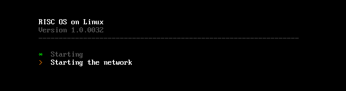

**Configure** has three new plug-ins: **Linux network**, **Updates** and
**Scroll wheel**.

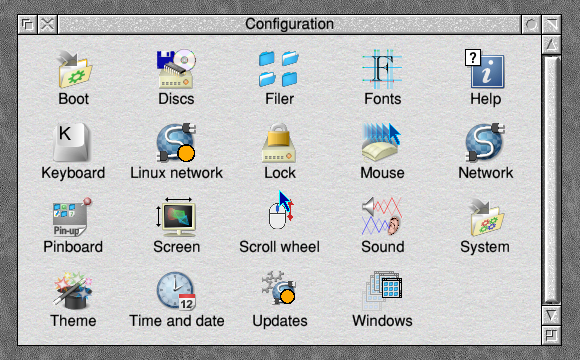

**Linux network** sets up wired or Wi-Fi networking, with DHCP or a fixed
address, and shows how the network is doing. RISC OS's own Internet
module uses it as it is, and RISC OS's name servers follow Linux's, so a
network that comes up late still works.

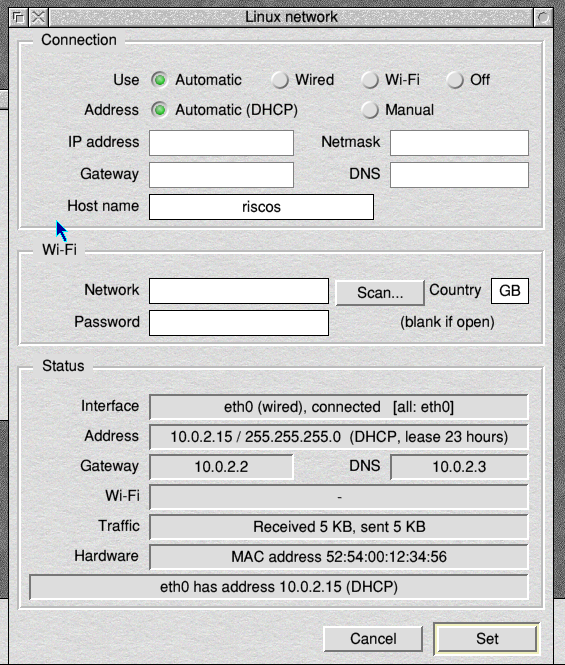

**Screen** starts the desktop at the monitor's own size. On a Pi it shows
the monitor by name, with its modes; under UTM, the window's size.
Resizing a virtual machine's window changes the mode to fit.

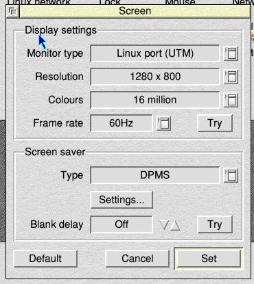

**Scroll wheel** scrolls the window under the pointer, either way round
(reversed, as on a Mac, if you like).

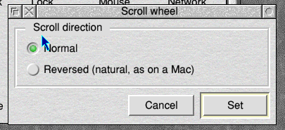

**Updates** keeps the whole machine up to date from the desktop: RISC OS
itself (the ROM), its Linux side, the kernel and the desktop parts come
as packages from [riscos-rolpkg](https://github.com/adyoull/riscos-rolpkg),
and Debian's security fixes come too.
- **Check for updates** shows the new versions.
- **Changes** says what each one changes before you install it.
- **Install updates** shows apt's progress as it goes.
- **Roll back RISC OS** puts back the build before. A new RISC OS that
  won't start goes back by itself if you put an empty `ROLLBACK` file on
  the card's FAT partition.

Here a 1.0.0018 machine is updated to this release:

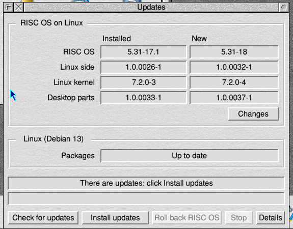

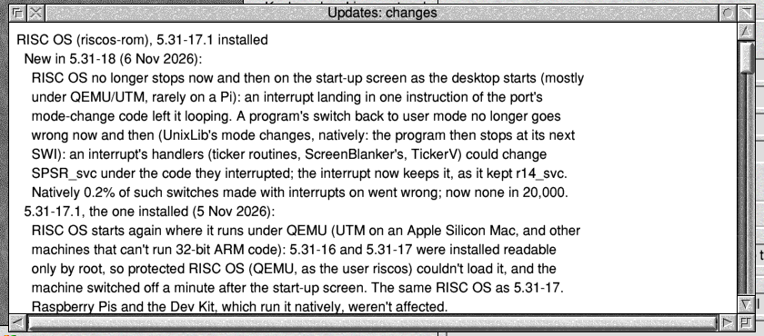

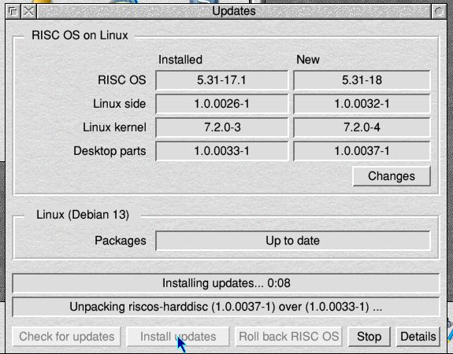

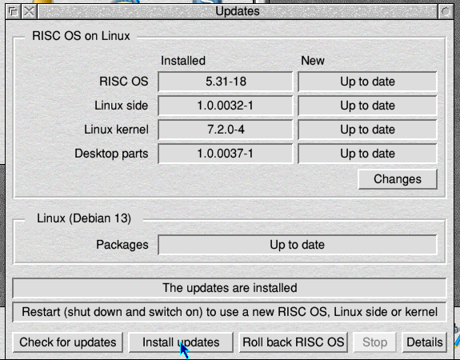

**`*Linux`** runs a Linux command from RISC OS and prints its output, in a
task window or at the command line. For example, `*Linux apt-get install
htop`.

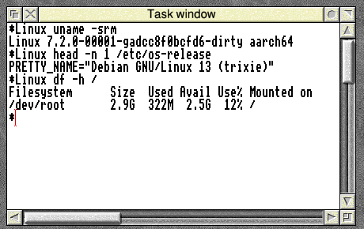

**Protected RISC OS:** RISC OS runs as an ordinary Linux user, so a RISC OS
program can't change Linux or reach the rest of the disc. `*Linux` and
Updates are the deliberate way through, so they ask for Linux's root
password, which you choose the first time. `*IXRun` runs Linux programs
as RISC OS's own Linux user, with no password.

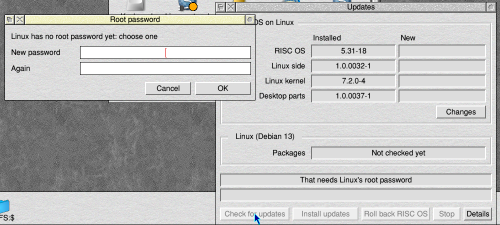

**Discs:**
- **HardDisc4** is a hard disc icon on the icon bar, with Open '$', Free
  (Linux's figures for the disc) and Dismount. It grows to fill the card
  or disc at the first start.
- **IXFS:$** shows what RISC OS can see of the Linux side.
- **USB discs and SD cards** appear on the icon bar when plugged in, named
  by their volume labels: FAT, exFAT, NTFS and ext4. Ones in RISC OS's own
  format (FileCore) appear as `SCSI::` drives, as on a native Pi. Eject
  is on their menu.

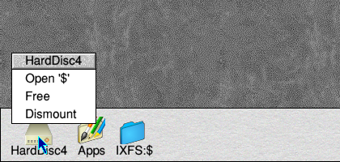
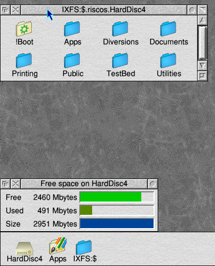
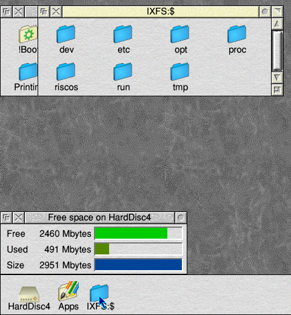

**And:**
- **The clock** is set from the internet as soon as the network is up, and
  kept across starts on a Pi, which has no clock battery.
- **Sound** comes from RISC OS's own sound modules, played through Linux:
  HDMI, the Pi's headphone socket or a USB sound card.
- **USB devices that Linux has no driver for** (phones, tablets and
  cameras in file transfer mode) are given to RISC OS programs through
  RISC OS's own USB interface. PDFS mounts phones this way.
- **Video:** LinuxCodec gives RISC OS programs the Pi's hardware H.264
  decoder, and Reel's video goes on the display's own overlay plane.
- **GPIO** on a Pi 3 or 4, for programs and the Raspberry Pi edition of
  ROOL's DDE.
- **Programs that come with it:** NetSurf, RDPServer and Folio (the PDF
  and ebook reader), installed as PackMan installs them, so PackMan
  upgrades them.
- **PackMan is already set up**, with nothing to add: RISC OS Open's
  two package lists, riscosdev.com's autobuilt packages (Iris, the web
  browser, among them) and [riscos-packages](https://github.com/adyoull/riscos-packages)
  (Andrew Youll's apps and ports). The certificates PackMan needs for the
  https lists are installed too (!CaCertificates).

## Tested

| Machine | |
|---|---|
| Raspberry Pi 4 | Andrew Youll: GPIO, and the Raspberry Pi DDE (RISC OS built with it) |
| Raspberry Pi 5 | Chris Gransden (1.0.0017) |
| Windows Dev Kit 2023 | Chris Gransden (1.0.0017) |
| UTM on an Apple Silicon Mac | Chris Gransden (1.0.0017); this release's QEMU in a Linux VM on an Apple Silicon Mac |
| QEMU (UEFI, Cortex-A76, natively) | this release's generic image and the Dev Kit image's root: the desktop, *Linux, RISC OS 5.31-19 and NativeSupport 0.33; with 5.31-19, a USB mouse at both mouse speeds, 4K in 16 million colours, menus and pointer moves, and the tablet; Iris 1.039 loads bbc.co.uk. With 1.0.0019's packages: Configure, the discs, 1.0.0018 updated through Updates; 39 of the 40 programs on the disc start |
| Raspberry Pi 3, Zero 2 W | untried |
| Pinebook, Pinebook Pro | untried: treat as experimental |

**Thank you to Chris Gransden** for his testing and reports: the UTM
start-up problem, the Updates error and the Iris 1.039 problem were his
finds.

## Known issues

- The Filer can stop with an abort in the kernel's sprite plotting when
  opening certain directories (seen with !RiscOSM's).
- On a Raspberry Pi, ROBench's BPut/BGet tests fail to open their file.
- Discs inside the machine in RISC OS's own format (FileCore on an
  internal SSD or NVMe) aren't offered to RISC OS; USB discs and SD cards
  are.
- Socket_Connect can report success for a connection that was refused.
- Iris isn't included: install it with PackMan (riscosdev.com's list is
  already set up).

Please send reports with the `LOGS` folder from the FAT partition.

## The full history

RISC OS on Linux started as a test bed on 15 October 2026, for running
Timothy Baldwin's Linux port of RISC OS on 64-bit ARM machines. Getting
here took 25 days: about 300 commits across the test bed, the build
(riscos-linux) and the package repository (riscos-rolpkg); 19 RISC OS
builds; 37 versions of the Linux side, 38 of the desktop parts and 10
kernel updates; and 20 image builds.

Newest first. Every package version is listed below, folded. Speed figures compare with RISC OS on Linux before that change, not with
native RISC OS. [Speed, measured](../docs/what-we-added.md#speed-measured) has both.

### 8 November, afternoon: this release (1.0.0020)

From Chris Gransden's report on a Raspberry Pi 5 with a 4K monitor, and
from EDT's and crossdev's developers:
- **RISC OS 5.31-19:**
  - Configure's mouse speed works with a mouse. Its movement now reaches
    RISC OS as movement, which RISC OS scales by the mouse speed, as on a
    Pi. It was taken as a position, so the speed was always one pixel per
    count: slow on a big screen. Tablets (UTM) work as before.
  - The screen can use up to 64 MB, so 4K and 5K work in 16 million
    colours, not only 32 thousand.
  - Programs that move the pointer move it on the screen.
  - A Thumb program's undefined instruction is reported at the right
    address; memory checks (OS_Memory 24) answer for PMP areas page by
    page under QEMU.
- **The pointer** (rol-fb): the right size on a 4K monitor (the desktop
  is 1920 × 1080 shown twice the size), and drawn where RISC OS has it
  from the start.
- **NativeSupport 0.32 and 0.33:** making or removing a dynamic area no
  longer stops the desktop with "Internal error: abort on data transfer"
  (EDT the debugger as it starts; static UnixLib programs as they end,
  during a ROM build for example).
- **UTM's monitor list** (Configure → Screen) has the common sizes from
  2880 × 1800 to 5120 × 2880.
- The images rebuilt with all of it.

### 8 November: 1.0.0019 (not published)

- **The SWI and error numbers RISC OS Open allocated:**
  - NativeSupport's SWIs are NativeSupport_PMPOp (&5AF40) and
    NativeSupport_AbortReturn (&5AF41), with names.
  - LinuxCodec's SWIs are &5AF00–&5AF08.
  - The modules' errors are &8235xx (LinuxAudio), &8236xx (LinuxCodec and
    the VideoCore stand-ins), &8237xx (LinuxShell) and &8238xx
    (NativeSupport).
- The images rebuilt with everything below.

### 6–7 November: Iris 1.039, and RISC OS 5.31-18

- **Iris 1.039 works** (NativeSupport 0.30): script-heavy pages such as
  bbc.co.uk stopped half-drawn. NativeSupport had prepared part of the
  browser's JavaScript engine (Thumb-2 code) as if it were ARM code.
- **The web browser's JavaScript compiler works**, and so do debuggers
  reading shared library memory.
- **The DDE's tools:** programs they save come out as they were written.
- **EDT starts**, and returns into Thumb-2 code keep their condition
  state.
- **RISC OS 5.31-18:**
  - RISC OS no longer stops now and then on the start-up screen.
  - An interrupt no longer spoils a program's switch back to user mode.
- **Big programs** (over 64 MB, like the web browser) **run natively**, and
  so does Iris 1.0.29 again.
- **Updates repairs damaged package lists** by itself (after a power cut
  during an update).
- **Configure → Screen** shows the monitor by name, with its modes.

### 5 November: 1.0.0018, Folio, and faster floating point

- **Folio**, the PDF and ebook reader, comes with it, and PDF files open
  in it.
- **FPA floating point about 4.5 times as fast on a Pi** (the fast FPA
  entry in the kernels).
- **The last session's logs are kept** after a restart or a power cut,
  with a note of how it ended.
- ARMEABISupport goes in !System.400, where PackMan's package puts it.
- **RISC OS starts again under QEMU** (5.31-17.1): 5.31-16 and -17 were
  installed readable only by root.

### 4 November: 1.0.0017; faster under QEMU, GPIO, StrongEd

- **Faster under QEMU** (UTM on a Mac): NEON's integer instructions run as
  the Mac's own vector instructions (ROBench's image tests 1.6 to 4.5
  times as fast). SWIs are about 1.25 times as fast.
- **GPIO on a Pi 3 or 4.** The Raspberry Pi DDE's C compiler and
  assembler run, and RISC OS itself has been built with it on a Pi 4.
- **Saving from StrongEd 4.70:** IXFS discs have a disc name, ROL.
- **Finer timing:** the hardware counter reloads every centisecond, as on
  a Pi (SDL games' frame timing).
- **Updates shows its progress** while installing. The drive icons survive
  a replacement pinboard.

### 3 November: faster natively; *IXRun; network servers; big files

- **Programs run faster natively:** NativeSupport 0.18 returns to programs
  without a Linux signal (RiscOSM's map drawing lost 10 of its 30 seconds
  to them).
- **`*IXRun` works**, as RISC OS's own Linux user, with no password; the
  new `*LinuxUser` too.
- **RDPServer and NetSurf** come with it.
- **Changes** in Updates: what an update brings, before installing it.
- **Files over 2 GB** on HardDisc4 and USB discs (up to 4 GB − 1).
- **Saving to HardDisc4 from StrongEd**, which checks the free space
  first.
- **A connection closed by the other end is seen at once** (ClawsMail's
  fetches took a minute each).
- **PDFS 0.16.2** for phones and cameras.

### 2 November: RISC OS's SWIs three times as fast; FileCore discs; video

- **The fast SWI entry** (NativeSupport 0.16 and the kernels): RISC OS's
  SWIs go straight to RISC OS instead of through Linux's security filter
  and a signal. On a Pi 4 that's 2.4 µs down to 745 ns per SWI (ROBench's
  OS_SWI 3.3 times as fast, BPUT 4.2).
- **FileCore discs:** USB sticks and SD cards in RISC OS's own format
  appear as `SCSI::` drives, with RISC OS Open's SCSIFS, and HForm can
  format them. They're handed over whole, opened exclusively, with every
  write on the disc before RISC OS is told it's done.
- **Video in hardware on a Pi:** Reel's video on the display's own plane,
  scaled, with no tearing.
- **Files get the type of their extension** (`photo/jpg` is a JPEG), as
  on DOS discs.
- **MbufManager in the ROM:** !Omni's LanManFS and Access work.
- **Network servers answer their clients** (RDPServer).
- The keyboard's LEDs follow RISC OS; SD cards in the machine's own slot
  work like USB sticks.

### 30 October – 1 November: the first packages and images

- **RISC OS 5.31:** RISC OS Open's nightly of 29 October merged into
  Timothy Baldwin's Linux port, which was RISC OS 5.29.
- **Packages and Updates:** RISC OS, its Linux side, the kernels and the
  desktop parts as Debian packages from a signed repository, kept up to
  date from Configure, with roll back.
- **Debian 13** as the base, with RISC OS protected as an ordinary user,
  and `*Linux` with a root password.
- **The images grow** to fill the card, **keep their logs** on the FAT
  partition, and **set the clock** by NTP.
- **A start-up screen**, and restart that restarts.
- **USB discs and SD cards** on the icon bar: FAT, exFAT, NTFS and ext4.
- **All the RAM Linux can give** (up to 4 GB). Proper RISC OS errors from
  HardDisc4, and the Locked attribute obeyed.
- **The Pi's H.264 decoder** for RISC OS programs (LinuxCodec).
- **Pinebook and Pinebook Pro** support, with Ubuntu's U-Boot.

### 15–29 October: the test bed

The work that made RISC OS on Linux run well, before there were packages
(test bed 0.1 to 0.10, and the images that followed):

- **Running natively** on processors that run 32-bit ARM programs (Pi 3,
  4 and 5, the Dev Kit), without QEMU: the NativeSupport module prepares
  RISC OS code for running as a Linux program and emulates what Linux
  won't do (0.10, 18 October).
- **QEMU made fast** for Macs, profiled while ROBench ran:
  - SWIs 4.8 times as fast;
  - floating point and NEON sent to the host's FPU and vector unit only
    where the answer can't differ (NEON 1.9 to 4.7 times as fast on a
    Mac);
  - checked against 20 million results bit for bit.
- **Sound:** RISC OS Open's own sound modules played through Linux.
- **The scroll wheel:** RISC OS Open's WindowScroll, built for the port.
- **Iris and ARMEABISupport 1.08:** physical memory pool areas, aborts and
  the timer that AcornSSL reads.
- **The screen** at the monitor's size, through Linux's DRM. Also USB
  keyboards and mice, wired and Wi-Fi networking, and UTM's ready-made
  machine.
- **The images:** the Raspberry Pi, UEFI, the Windows Dev Kit 2023 and UTM.

<b>Every version of RISC OS (riscos-rom)</b>

| Version | Date | What changed |
|---|---|---|
| 5.31-29 | 13 Nov | OS_RemoveTickerEvent turns interrupts off (the ticker chain could be left circular: the desktop stopped dead) |
| 5.31-28 | 11 Nov | RAM discs (FileCore's compaction) no longer stop with "FileCore in use"; a pointer set past a file's end extends it on IXFS |
| 5.31-24 | 11 Nov | Dynamic areas placed as on native RISC OS (lowest free address first); the RAM disc up to 2 GB; a pointer turned off goes off; room for SWIs without a trap |
| 5.31-19 | 8 Nov | Configure's mouse speed works with a mouse; 4K and 5K in 16 million colours (64 MB screen); programs moving the pointer move it on screen |
| 5.31-18 | 6 Nov | No more stops on the start-up screen as the desktop starts; an interrupt no longer spoils a program's switch back to user mode (SPSR_svc kept) |
| 5.31-17.1 | 5 Nov | Starts again under QEMU (5.31-16 and -17 were readable only by root) |
| 5.31-17 | 4 Nov | GPIO on a Pi 3 or 4, for programs and the Raspberry Pi DDE |
| 5.31-16 | 4 Nov | IXFS discs have a disc name, ROL, so StrongEd 4.70 can save |
| 5.31-15 | 4 Nov | The hardware counter reloads every centisecond (finer timing) |
| 5.31-14 | 3 Nov | *IXRun through the shell, as RISC OS's own Linux user |
| 5.31-13 | 3 Nov | Files over 2 GB |
| 5.31-12 | 3 Nov | A closed connection seen at once; IXFS's free space (StrongEd) |
| 5.31-10 | 2 Nov | FileCore discs as `SCSI::` drives; the keyboard LEDs |
| 5.31-8 | 2 Nov | Files get their extension's type; MbufManager in the ROM; servers answer their clients |
| 5.31-6 | 1 Nov | Socket options for GLib programs |
| 5.31-5 | 31 Oct | The Internet module reports 5.73 (!Omni starts) |
| 5.31-4 | 31 Oct | Socket_Select's timeout; locked files can't be renamed |
| 5.31-3 | 31 Oct | RISC OS errors from HardDisc4; physical memory pools in the kernel |
| 5.31-2 | 31 Oct | All the RAM Linux can give (up to 4 GB); network statistics |
| 5.31-1 | 30 Oct | RISC OS Open's 5.31 nightly merged into the Linux port (5.29) |

<b>Every version of the Linux side (riscos-support)</b>

| Version | Date | What changed |
|---|---|---|
| 1.0.0053-1 | 13 Nov | rol-snd sets the card's mixer controls when it opens it (Pinebook Pro's ES8316, Pinebook's A64 codec; `set=Name=value` in /riscos/sound/config) |
| 1.0.0052-1 | 13 Nov | rol-netd: `wifi_pmf=off` (key_mgmt=WPA-PSK, ieee80211w=0) |
| 1.0.0051-1 | 12 Nov | NativeSupport 0.48: a program UnSqueezeAIF is unsqueezing isn't scanned; CPS patched only in encodings the processor takes |
| 1.0.0050-1 | 12 Nov | NativeSupport 0.47: a word loaded pc-relative as a literal is left unpatched (256000.0 = MRSMI r4, CPSR) |
| 1.0.0049-1 | 12 Nov | init starts /opt/riscos/rol-3d (RISC3D's Linux helper) if present |
| 1.0.0048-1 | 12 Nov | rol-fb: a plane per overlay connection (up to 4), RGB overlays, planes set by atomic commits that don't wait (one a frame for all), no black flash at the first open or last close |
| 1.0.0047-1 | 12 Nov | rol-cmd notes each root password set or refused in /var/log/rol-cmd.log (length, non-ASCII count, whether right with case swapped; never the password) |
| 1.0.0046-1 | 12 Nov | rol-discd: internal FileCore discs and partitions given to RISC OS at start-up |
| 1.0.0045-1 | 12 Nov | NativeSupport 0.46: patched words in files written in pieces; a faulting privileged load or store is a data abort; no slow SWIs after an instruction that can't be done |
| 1.0.0044-1 | 11 Nov | rol-cmd for RiSH: terminal type, window size, output space given back; 16 commands at once |
| 1.0.0042-1 | 11 Nov | rol-cmd: Linux commands on a terminal (interactive `*IXRun`, `*LinuxUser` and `*Linux`) |
| 1.0.0041-1 | 11 Nov | NativeSupport 0.45: the busiest SWIs without a trap; rol-snd: the headphone socket when the screen has no speakers |
| 1.0.0038-1 | 9 Nov | Touchpads move the pointer like a mouse; Wi-Fi power saving off; the network's logs in LOGS |
| 1.0.0037-1 | 8 Nov | rol-fb: the pointer drawn where RISC OS has it from the start |
| 1.0.0036-1 | 8 Nov | NativeSupport 0.33: the same after a dynamic area is removed (static UnixLib programs ending) |
| 1.0.0035-1 | 8 Nov | NativeSupport 0.32: making a dynamic area no longer stops the desktop |
| 1.0.0034-1 | 8 Nov | rol-fb 3: mouse movement to RISC OS as movement (its mouse speed applies, with 5.31-19); modes up to 64 MB listed |
| 1.0.0033-1 | 8 Nov | rol-fb: the pointer the right size on a 4K monitor |
| 1.0.0032-1 | 8 Nov | NativeSupport 0.31: RISC OS Open's SWI and error numbers |
| 1.0.0031-1 | 7 Nov | NativeSupport 0.30: Iris 1.039, the JavaScript compiler, the DDE's tools, EDT, debuggers |
| 1.0.0030-1 | 6 Nov | Iris 1.0.29 starts natively again |
| 1.0.0029-1 | 6 Nov | Big programs (over 64 MB) natively; Configure → Screen shows the monitor |
| 1.0.0028-1 | 5 Nov | FPA floating point about 4.5 times as fast on a Pi |
| 1.0.0027-1 | 5 Nov | The last session's logs kept, and how it ended |
| 1.0.0026-1 | 4 Nov | Faster under QEMU: NEON integer, quicker jumps |
| 1.0.0025-1 | 4 Nov | GPIO registers for protected RISC OS |
| 1.0.0024-1 | 3 Nov | Commands as RISC OS's own Linux user (*IXRun, *LinuxUser) |
| 1.0.0023-1 | 3 Nov | Each package's changes, for Updates' Changes |
| 1.0.0022-1 | 3 Nov | NativeSupport 0.18: returns without a signal; Eject retries |
| 1.0.0021-1 | 3 Nov | The FAT partition never left mounted at a restart |
| 1.0.0020-1 | 2 Nov | SD cards in the machine's own slot, like USB sticks |
| 1.0.0019-1 | 2 Nov | FileCore discs given whole; fixed and removable drives |
| 1.0.0018-1 | 2 Nov | The keyboard LEDs; FileCore discs handed to RISC OS |
| 1.0.0017-1 | 2 Nov | NativeSupport 0.16: the fast SWI entry |
| 1.0.0016-1 | 2 Nov | USB disc files not marked executable |
| 1.0.0015-1 | 2 Nov | Reel's video on the display's video plane |
| 1.0.0014-1 | 1 Nov | USB discs and SD cards in RISC OS |
| 1.0.0013-1 | 31 Oct | Shutdown leaves the disc clean |
| 1.0.0012-1 | 31 Oct | Updates shows apt's progress line by line |
| 1.0.0011-1 | 31 Oct | Only what changed on the screen is redrawn |
| 1.0.0009-1 | 31 Oct | Restart restarts |
| 1.0.0008-1 | 31 Oct | /dev/pts mounted (apt's log) |
| 1.0.0007-1 | 31 Oct | Alt+Shift+Backspace as Break |
| 1.0.0006-1 | 31 Oct | The start-up screen |
| 1.0.0004-1 | 31 Oct | The clock set by NTP and kept; RISC OS's RAM from what Linux has free |
| 1.0.0002-1 | 31 Oct | The disc grows to fill the card; logs on the FAT partition |
| 1.0.0001-1 | 30 Oct | The first |

<b>Every version of the desktop parts (riscos-harddisc)</b>

| Version | Date | What changed |
|---|---|---|
| 1.0.0054-1 | 13 Nov | MemMapEntries 0.05 (its address table could be placed in the staging space of a page move and lost with it); PThreadTicker 0.04 as System:Modules.PThrTicker (`/usr/lib/riscos/place-pthreadticker`) |
| 1.0.0053-1 | 13 Nov | MemMapEntries 0.04 in TestBed.Modules, loaded from PreDesk.TestBed: OS_FindMemMapEntries, OS_SetMemMapEntries, OS_ReadMemMapEntries (Linux mremap) |
| 1.0.0052-1 | 13 Nov | Linux network 1.01: keeps config lines it has no field for |
| 1.0.0051-1 | 12 Nov | Updates 1.02: Show option and Caps Lock warning in the password window |
| 1.0.0050-1 | 12 Nov | SCSILinux 0.02: internal FileCore discs as SCSI:: hard discs |
| 1.0.0049-1 | 11 Nov | RiSH 0.04: other programs' system font text is no longer drawn half height after a RiSH window redraws |
| 1.0.0048-1 | 11 Nov | RiSH's licence files (MIT; UnixLib's) in the application and Documents.Licences |
| 1.0.0047-1 | 11 Nov | RiSH 0.03: copy and paste |
| 1.0.0046-1 | 11 Nov | RiSH 0.02: its full name, the RISC Shell, in Info and !Help |
| 1.0.0045-1 | 11 Nov | RiSH 0.01 (the RISC Shell), the Linux terminal, in Apps |
| 1.0.0043-1 | 11 Nov | LinuxShell 0.04: `*IXRun`, `*LinuxUser` and `*Linux` are interactive, and a shell with no command |
| 1.0.0040-1 | 11 Nov | CaCertificates as PackMan's own package: installing Iris no longer reports a file conflict |
| 1.0.0039-1 | 8 Nov | Folio and RDPServer no longer get every file twice; PackMan can upgrade them |
| 1.0.0038-1 | 8 Nov | UTM's monitor list with 4K and 5K sizes |
| 1.0.0037-1 | 8 Nov | LinuxCodec, LinuxAudio and LinuxShell: RISC OS Open's numbers |
| 1.0.0036-1 | 6 Nov | Updates repairs damaged package lists |
| 1.0.0035-1 | 6 Nov | The sound, USB and SCSI modules keep SPSR_svc in their tickers |
| 1.0.0034-1 | 5 Nov | ARMEABISupport in !System.400, where PackMan puts it |
| 1.0.0033-1 | 5 Nov | PDF files open in Folio however the boot is ordered |
| 1.0.0032-1 | 5 Nov | Folio, the PDF and ebook reader |
| 1.0.0031-1 | 5 Nov | Updates: "String too long at line 445" fixed |
| 1.0.0030-1 | 4 Nov | IXFS:$ on the icon bar, labelled IXFS:$ |
| 1.0.0029-1 | 4 Nov | Updates shows what it's doing while it installs |
| 1.0.0028-1 | 4 Nov | The drive icons start from their own boot file |
| 1.0.0027-1 | 3 Nov | NetSurf 3.11 |
| 1.0.0026-1 | 3 Nov | RDPServer 0.2 |
| 1.0.0025-1 | 3 Nov | *IXRun always through *LinuxUser |
| 1.0.0024-1 | 3 Nov | PDFS 0.16.2 beta |
| 1.0.0023-1 | 3 Nov | *IXRun as RISC OS's own Linux user |
| 1.0.0022-1 | 3 Nov | *IXRun through *Linux |
| 1.0.0021-1 | 3 Nov | Updates' Changes window |
| 1.0.0020-1 | 3 Nov | !DiscIcon: windows close on eject; a busy disc reported |
| 1.0.0019-1 | 2 Nov | SCSILinux: removable or fixed as Linux says |
| 1.0.0018-1 | 2 Nov | SCSILinux at start-up (FileCore discs) |
| 1.0.0017-1 | 2 Nov | LinuxOverlay (Reel's video in hardware); *USBDevices lists Linux's devices |
| 1.0.0016-1 | 1 Nov | The removable drive icon; MbufManager for older ROMs |
| 1.0.0015-1 | 1 Nov | GCCSDK's ARMEABISupport 1.05 |
| 1.0.0014-1 | 31 Oct | The VideoCore stand-ins (ReelHWAccel's H.264) |
| 1.0.0013-1 | 31 Oct | Updates stays open while installing |
| 1.0.0012-1 | 31 Oct | NetWatch reads the network in one go |
| 1.0.0010-1 | 31 Oct | LinuxCodec at start-up |
| 1.0.0009-1 | 31 Oct | LinuxCodec 0.03 |
| 1.0.0007-1 | 31 Oct | LinuxCodec: the Pi's H.264 decoder |
| 1.0.0006-1 | 31 Oct | NetWatch and Updates fixes |
| 1.0.0004-1 | 31 Oct | NetWatch: name servers follow the network |
| 1.0.0001-1 | 30 Oct | The first |

<b>Every kernel update</b>

| Kernel | Version | Date | What changed |
|---|---|---|---|
| Pi | 6.6.78-8 | 11 Nov | config.txt: `dtparam=audio=on` before the overlays, for the headphone socket |
| Pi | 6.6.78-7 | 11 Nov | The Pi 5's fan driver (pwm-fan) |
| Dev Kit | 7.2.0-4 | 6 Nov | The fast FPA entry |
| Pi | 6.6.78-6 | 5 Nov | The fast FPA entry (FPA 4.5 times as fast on a Pi 4) |
| generic | 7.2.0-4 | 5 Nov | The fast FPA entry |
| Pi | 6.6.78-5 | 4 Nov | /dev/gpiomem for RISC OS's GPIO |
| Pi | 6.6.78-4 | 2 Nov | The fast SWI entry (2.4 µs to 745 ns per SWI) |
| generic, Dev Kit | 7.2.0-3 | 2 Nov | The fast SWI entry |
| Pi | 6.6.78-3 | 1 Nov | NTFS discs |
| generic, Dev Kit | 7.2.0-2 | 1 Nov | exFAT discs and fast USB discs (UAS) |
| Pi | 6.6.78-2 | 31 Oct | The kernels keep their own versions |
| generic, Dev Kit | 7.2.0-1 | 31 Oct | The same |

The full details of every change are in
[riscos-rolpkg's CHANGELOG](https://github.com/adyoull/riscos-rolpkg/blob/main/CHANGELOG.md)
and in Configure → Updates → Changes.

## Source and licences

All the source is at [riscos-linux](https://github.com/adyoull/riscos-linux)
(RISC OS 5.31-28, the one in Updates, on the `riscos-5.31-source` branch; the images' 5.31-19 is in its history). Each image carries
`SOURCE.txt` and a `LICENCES` folder on its FAT partition, and
HardDisc4.Documents.Licences and .Source.

Copyright (c) 2026 Andrew Youll. MIT licence (see LICENSE).
