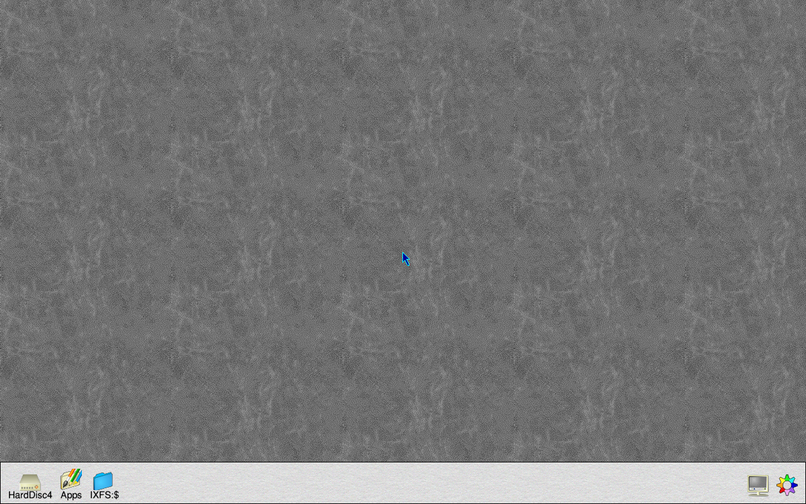

# RISC OS on Linux 1.0.0055 (14 November 2026)

RISC OS 5.31 (5.31-29: RISC OS Open's nightly in Timothy Baldwin's Linux
port) on Debian 13, for 64-bit ARM machines: Raspberry Pis, UEFI
machines and virtual machines, Apple Silicon Macs (UTM), the Windows
Dev Kit 2023 and the Pinebooks. RISC OS runs straight on the processor
where it can (Raspberry Pi 3, 4 and 5, the Dev Kit, the Pinebooks) and
under QEMU where it can't (Apple's processors).

New images with every update since [1.0.0020](1.0.0020.md) already in
them. **Already running 1.0.0020 or an earlier test build? Configure →
Updates brings it to exactly this**, without writing a card again.

Since these images were made: `riscos-support` 1.0.0056-1 (15 Nov),
which only stops three unneeded Debian firmware packages being
installed with updates; the images never had them. Configure → Updates
brings it.

The number is now the one the start-up screen shows (the version of
RISC OS on Linux's Linux side), which is why it jumps from 1.0.0020.

This is a test release. **Its Linux kernels are new and at the time of
writing have only been started in emulation** (see Tested): if you have
a working 1.0.0020 card, keep it until this one has started on your
machine. Please [report](../README.md#reporting-a-problem) what works
and what doesn't.

## The images

| Image | For | File |
|---|---|---|
| Generic | Raspberry Pi 3/3B+/CM3, Zero 2 W, 4/400/CM4, 5/500/CM5; UEFI machines (QEMU, ARM boards and servers); Pinebook and Pinebook Pro | `riscos-generic.img.xz` |
| UTM | Apple Silicon Macs | `RISC OS 1.0.0055.utm` (in `RISC OS 1.0.0055.utm.zip`) |
| Windows Dev Kit 2023 | Snapdragon 8cx Gen 3 ("Project Volterra") only | `riscos-wdk2023.img.xz` |

Write the .img.xz to a card or USB disc with Raspberry Pi Imager ("Use
custom") or balenaEtcher. Unzip the .utm and double-click it to add it to
UTM. Each image starts straight into the RISC OS desktop; Shutdown powers
the machine off. `SHA256SUMS` lists the files' checksums. How to install
on each machine is in [the README](../README.md#installing).

The downloads are nearly twice the size of 1.0.0020's (about 205 MB,
180 MB and 355 MB): most of the
difference is the firmware of Wi-Fi and network adapters (Debian's own
firmware packages, about 280 MB on the card).

The Dev Kit image is only for the Dev Kit: anywhere else Linux finds no
screen and the machine switches off a minute later.

## New since 1.0.0020

The headlines:

- **Wi-Fi, Ethernet and mobile broadband adapters that you plug in or
  fit** have drivers, loaded when the adapter is found: USB Wi-Fi
  adapters (Realtek, MediaTek and Ralink, Atheros chips), USB Ethernet
  adapters, phones and mobile broadband sticks, PCI Express Wi-Fi and
  Ethernet cards, and the Windows Dev Kit 2023's own Wi-Fi.
- **Compute Modules:** the Compute Module 5 and 5 Lite start, and the IO
  boards' USB sockets work (keyboard, mouse, USB drives).
- **Pi 500 and newer Pi 5 boards** start.
- **Programs that now run:** Photodesk, OvationPro, ChartDraw, MultiPlot.
- **RiSH**, a Linux terminal for the desktop, in Apps; `*IXRun` and
  `*Linux` are interactive.
- **Internal drives in RISC OS's own format** appear as hard discs.
- **Laptops:** touchpads work like a mouse; sound on the Pinebooks.
- **The headphone socket** on a Raspberry Pi 3 or 4.
- **RAM discs** up to 2 GB, which no longer fail when they have to make
  room.
- **The desktop no longer stops dead** some minutes after a busy timer
  (RISC OS 5.31-29).

Every update, newest first:

| Date | Package | What changed |
|---|---|---|
| 14 Nov | `riscos-kernel-pi` 6.6.78-14, `riscos-kernel-generic` and `riscos-kernel-wdk2023` 7.2.0-7 | **The firmware of two more families of USB Wi-Fi adapter** comes with the kernel: Atheros AR9271 and AR7010 adapters (the TP-Link TL-WN722N version 1 and many others) and AR9170 ones, from two small Debian packages (`firmware-ath9k-htc`, `firmware-carl9170`). |
| 14 Nov | `riscos-kernel-pi` 6.6.78-13, `riscos-kernel-generic` and `riscos-kernel-wdk2023` 7.2.0-6, `riscos-support` 1.0.0055-1 | **Wi-Fi, Ethernet and mobile broadband adapters that you plug in or fit.** Until now only each machine's own Wi-Fi and network worked. Linux's drivers for USB Wi-Fi adapters (Realtek, MediaTek and Ralink, Atheros chips, which is most of them), USB Ethernet adapters and phone or mobile broadband sticks, and for Wi-Fi and network cards fitted inside a machine (Intel, Realtek, MediaTek, Qualcomm Atheros, including the Windows Dev Kit 2023's own Wi-Fi), are now there and are loaded when the adapter is found, at start-up or when it is plugged in. Then set it up as usual in Configure → Linux network. A USB Wi-Fi adapter is used in preference to built-in Wi-Fi, and a wired connection with a cable in is used first of all. The adapters' firmware comes from Debian's own firmware packages, which this update adds to the system (it turns on Debian's `non-free-firmware` section for that); they are a big download, a hundred megabytes or more, so the update takes longer than usual, and Updates goes through its steps twice. **Tried in emulation only**, where a network adapter was recognised and connected; no real USB Wi-Fi adapter has been tried, and the new kernels have not yet been started on a real machine. Please [report](https://github.com/adyoull/RISCOSonLinux/issues) what works and what doesn't, with the adapter's make and model and `kernel-log.txt` from the card's `LOGS` folder. If the machine doesn't start after this update, put a file called `ROLLBACK` on the card's FAT partition to go back. |
| 14 Nov | `riscos-kernel-pi` 6.6.78-13 | **Compute Modules whose USB sockets didn't work** (no keyboard or mouse, USB drives ignored, a black screen when started from a USB drive; Chris Hall's report with a Compute Module 5 Lite): the update makes the change to `config.txt` that the IO boards' USB sockets need and adds the file it uses. A board that can't be used to run the update can be fixed by hand: see [Compute Module 5, Pi 500 and newer Pi 5 boards](../docs/install-raspberry-pi.md#compute-module-5-pi-500-and-newer-pi-5-boards). Not tried on a Compute Module here. |
| 12 Nov | `riscos-kernel-pi` 6.6.78-9 | **Linux's driver for the Raspberry Pi 4 and 5's 3D hardware (v3d).** Nothing uses it yet: it is groundwork for 3D acceleration of RISC OS programs, being prototyped. Not yet booted on a Pi: if the machine doesn't start after this update, a file called `ROLLBACK` on the card's FAT partition goes back. |
| 13 Nov | `riscos-kernel-pi` 6.6.78-11 | **Compute Module 5, Pi 500 and newer Pi 5 boards** (the "D0" version of the processor): Linux stopped half a second after starting with "Kernel panic - not syncing: Asynchronous SError Interrupt", because the boot files lacked `overlays/bcm2712d0.dtbo`, from which the Pi's firmware adjusts the device tree for that processor. Added (not tried on these boards here: reports welcome). **The 8 Nov image still lacks it:** see [Installing on a Raspberry Pi](../docs/install-raspberry-pi.md#compute-module-5-pi-500-and-newer-pi-5-boards) for the files and where to put them. |
| 13 Nov | `riscos-kernel-pi` 6.6.78-10 | **Compute Module 5 Lite** (the CM5 without built-in storage): the image's boot files lacked its two device tree files, so the Pi's firmware said the system "does not indicate support for the Raspberry Pi 5" and Linux then stopped with a kernel panic. Added (not tried on a CM5: reports welcome). **The 8 Nov image still lacks them:** on a CM5 Lite, copy `bcm2712-rpi-cm5l-cm5io.dtb` and `bcm2712-rpi-cm5l-cm4io.dtb` onto the card's first (FAT) partition from another computer; they are in [cm5-lite-dtbs.zip](../docs/files/cm5-lite-dtbs.zip). |
| 13 Nov | `riscos-harddisc` 1.0.0054-1 | **Photodesk: large pictures.** Image > Rotate on a full-size picture gave "PhotoDesk has suffered an unexpected error" (reported by George Greenfield with 3.22; reproduced and fixed here with 3.14 and a 1280x800 24-bit picture). **PThreadTicker 0.04** (the thread timer that programs built with UnixLib use, for sound among other things) is now in !System, so programs find the current one before any older copy of their own. |
| 13 Nov | `riscos-harddisc` 1.0.0053-1 | **Photodesk runs** (3.14 tried: it starts, makes a new picture and paints; loading and saving, big pictures and 3.22 are not yet tried, so reports are welcome). It stopped at start-up with a garbled error box: it rearranges the memory its pictures are in page by page, with calls RISC OS on Linux never had. A new module, MemMapEntries, provides them; it is loaded at start-up and does nothing until a program asks. Other programs with their own virtual memory may now run too. |
| 13 Nov | `riscos-rom` 5.31-29 | **The desktop stopping dead, with only Ctrl-Break working, some minutes after a program that uses timers was busy or was stopped** (reported after stopping !ROBench with Escape on a Pi 4): fixed. RISC OS removed a timer with interrupts on where they should have been off, and a clock tick at just the wrong moment could tie its list of timers in a loop. It was rare, and wasn't reproduced here: the fix is checked in the built ROM. |
| 13 Nov | `riscos-support` 1.0.0053-1 | **Sound on the Pinebook Pro and the Pinebook** (not yet tried on either: reports welcome). Their sound chips start with the outputs switched off, and nothing switched them on, so Configure showed the sound device and nothing was heard. They are now set each time sound starts. If it is too quiet or too loud on a Pinebook Pro, add a line such as `set=Headphone Playback Volume=3` (0 to 3) to the file `IXFS:$.riscos.sound.config` and restart. Other machines aren't changed. |
| 13 Nov | `riscos-support` 1.0.0052-1, `riscos-harddisc` 1.0.0052-1 | **If Wi-Fi joins a network and is then dropped, over and over**, there is a setting to try: add the line `wifi_pmf=off` to the file `IXFS:$.riscos.net.config` (load it into Edit, add the line, save) and restart. It turns off a newer part of Wi-Fi security that some Wi-Fi chips and some routers don't agree on; WPA2 still protects the connection. The network configuration window now also keeps such extra lines when you click Set. |
| 12 Nov | `riscos-support` 1.0.0051-1 | **OvationPro starts** (it stopped with "undefined instruction at &00008070"). Programs packed with old versions of the squeeze tool could be spoiled as they were unpacked. |
| 12 Nov | `riscos-support` 1.0.0050-1 | **ChartDraw and MultiPlot start** (they stopped with "Floating point exception: invalid operation"): a number inside the program was mistaken for a processor instruction and spoiled. Other programs that failed the same way as they started may now run too (Photodesk and OvationPro were reported with them and haven't been tried). |
| 12 Nov | `riscos-support` 1.0.0049-1 | Start-up runs RISC3D's helper if it has been installed (by RISC3D's test kit: it isn't part of any update yet). No change on a machine without it. |
| 12 Nov | `riscos-support` 1.0.0048-1 | **Several hardware overlays at once on the display, and RGB ones as well as video.** This is the groundwork for 3D drawn by the graphics chip in a desktop window (RISC3D, still a prototype): nothing uses the new overlays yet, and video plays as before. If the display misbehaves after this update, make an empty file `/riscos/overlay-legacy` and restart. |
| 12 Nov | `riscos-support` 1.0.0047-1, `riscos-harddisc` 1.0.0051-1 | **The root password window in Updates has a Show option and says when Caps Lock is on.** The password is typed unseen, so one typed with Caps Lock on (or on a keyboard set up differently) was a different password with nothing to show it. Linux also keeps a note of each password set or refused (never the password itself) in `/var/log/rol-cmd.log`. Existing passwords are untouched. |
| 12 Nov | `riscos-support` 1.0.0046-1, `riscos-harddisc` 1.0.0050-1 | **Internal drives in RISC OS's own format appear as hard discs:** an NVMe, SATA or eMMC drive formatted by RISC OS (FileCore), or a FileCore partition on one, is found at start-up and shows as a `SCSI::` hard disc with its icon, read and write. Linux's own partitions are never offered. Tested with emulated discs only so far: reports from real drives welcome. |
| 12 Nov | `riscos-support` 1.0.0045-1 | **NativeSupport 0.46:** a program that writes its own code to a file in pieces no longer leaves a patch marker in it; a privileged load or store that hits bad memory is reported as "abort on data transfer", as on a real machine; SWIs are no slower for ten seconds after a program meets an instruction it isn't allowed. |
| 11 Nov | `riscos-rom` 5.31-28 | **RAM discs no longer fail when they have to make room:** writing a lot to a RAM disc (a ROM build on one, say) stopped after a few seconds, and everything after that said "FileCore in use" until a restart (Chris Gransden's report). FileCore's tidying of the disc's map went wrong here, for RAM discs and FileCore-format USB discs alike. **Setting a file's pointer past its end extends the file at once on HardDisc4 and USB discs too**, as RISC OS does everywhere else (the web browser project's report). |
| 11 Nov | `riscos-harddisc` 1.0.0043-1, `riscos-support` 1.0.0042-1 | **`*IXRun`, `*LinuxUser` and `*Linux` are interactive:** what you type goes to the Linux program, so one that asks a question or wants a password can be answered (apt-get's "Do you want to continue? [Y/n]", passwd). With no command they start a shell: `*IXRun` as RISC OS's own Linux user, `*Linux` as root after the root password. Escape is Ctrl-C; Escape twice quickly stops the command. Full-screen programs (nano, top) don't work yet. See [Using it](../docs/using.md#linux-commands-from-risc-os-linux-ixrun-and-the-root-password). |
| 11 Nov | `riscos-harddisc` 1.0.0049-1, `riscos-support` 1.0.0044-1 | **RiSH (the RISC Shell), a Linux terminal for the desktop** (new, in Apps): each window is a Linux shell, and full-screen programs work in it (editors, top, anything written for an xterm), in colour, with a resizable window and 1000 lines of scrollback. Text can be copied and pasted between it and other RISC OS programs. A root terminal is on its icon bar menu. See [Using it](../docs/using.md#rish-the-linux-terminal). |
| 11 Nov | `riscos-kernel-pi` 6.6.78-8 | **The headphone socket on a Raspberry Pi 3 or 4:** Linux had no headphone socket, so sound could only go to HDMI or a USB sound adapter. One line of the card's `config.txt` was in the wrong place (`dtparam=audio=on` has to come before the overlays); the update moves it and keeps the file as it was as `config.txt.old`. Restart afterwards. Not yet confirmed on a Pi: please report (Ralph Barrett's report). |
| 11 Nov | `riscos-kernel-pi` 6.6.78-7 | **The Raspberry Pi 5's fan runs** (the official Active Cooler or a case fan): Linux's fan driver wasn't in the kernel, so the fan never started. **Reported not to work yet on a Pi 5** (David Pitt: the driver is there, the fan doesn't start): being looked into. |
| 11 Nov | `riscos-rom` 5.31-24, `riscos-support` 1.0.0041-1 | **Memory behaves as on a real RISC OS machine at the edges of dynamic areas:** a new area goes at the lowest free address, so running off its end stops with a data abort, as on a Pi running RISC OS, instead of quietly reaching the next area. **The RAM disc can be up to 2 GB.** **A pointer turned off goes off** (!RDPClient over its window). **Faster natively:** the busiest SWI calls go straight to RISC OS without a trap (NativeSupport 0.45). **Sound from the headphone socket** when the screen has no speakers. |
| 11 Nov | `riscos-harddisc` 1.0.0040-1 | **Installing Iris with PackMan no longer stops with "One or more files conflict":** CaCertificates is now PackMan's own package, with its record (Ralph Barrett's report). |
| 9 Nov | `riscos-support` 1.0.0038-1 | **Laptop touchpads work like a mouse** (the Pinebook Pro's): taps and two-finger scrolling. Wi-Fi power saving is off, which stopped the Pinebook Pro's Wi-Fi dropping (Raik's report). |
| 8 Nov | `riscos-harddisc` 1.0.0039-1 | **Folio or RDPServer no longer end up with every file twice,** and PackMan can upgrade them again. |

## Versions in this release

| Package | Version |
|---|---|
| RISC OS (`riscos-rom`) | 5.31-29 |
| The Linux side (`riscos-support`) | 1.0.0055-1 |
| The desktop parts (`riscos-harddisc`) | 1.0.0054-1 |
| Kernels | Pi 6.6.78-14; generic and Dev Kit 7.2.0-7 |
| Adapters' firmware | Debian's `firmware-realtek`, `firmware-mediatek`, `firmware-atheros`, `firmware-misc-nonfree`, `firmware-iwlwifi` 20250410-2, `firmware-ath9k-htc`, `firmware-carl9170` |

## Tested

| Machine | |
|---|---|
| QEMU, as a UEFI machine | this release's generic image, started from the image by UEFI firmware: the desktop; a PCI network card's driver loaded and the network up |
| QEMU, as a Raspberry Pi 3 | this release's generic image with its Pi kernel: RISC OS starts; a USB network adapter's driver loaded and the network up |
| Updating from 1.0.0020 | under QEMU, against copies of Debian's real firmware packages: one press of Install brought a 1.0.0020 system to these versions, and it started on the new kernel |
| Raspberry Pi 3, 4, 5, Compute Modules | **this release's kernel not yet confirmed on real hardware** |
| Windows Dev Kit 2023 | **not yet confirmed** (it can't be emulated): its Wi-Fi is new and untried |
| UTM on an Apple Silicon Mac | not yet confirmed with this release |
| Pinebook, Pinebook Pro | untried: treat as experimental |
| Real USB Wi-Fi adapters, Huawei sticks | untried: please report, with the adapter's make and model and `kernel-log.txt` from the card's `LOGS` folder |

Thank you to Chris Gransden, George Greenfield, Chris Hall, Raik, David
Pitt and Ralph Barrett for their testing and reports.

## Known issues

- The Filer can stop with an abort in the kernel's sprite plotting when
  opening certain directories (seen with !RiscOSM's).
- On a Raspberry Pi, ROBench's BPut/BGet tests fail to open their file.
- The Raspberry Pi 5's fan is reported not to start, though its driver
  is there: being looked into.
- Wi-Fi has been reported slow on a Raspberry Pi 4 and a Pinebook Pro
  (a few megabits a second): being looked into; logs welcome.
- OvationPro has been reported not to start from HardDisc4 while
  starting from a FileCore disc: being looked into.
- Debian's firmware (April 2025) is older than the generic kernel, so
  the very newest Wi-Fi chips may lack firmware.
- Socket_Connect can report success for a connection that was refused.
- Iris isn't included: install it with PackMan (riscosdev.com's list is
  already set up).

Please send reports with the `LOGS` folder from the FAT partition.

## The full history

[1.0.0020's notes](1.0.0020.md#the-full-history) have the history up to
8 November; the table above carries on from there, and
[riscos-rolpkg's CHANGELOG](https://github.com/adyoull/riscos-rolpkg/blob/main/CHANGELOG.md)
has every package version.

## Source and licences

As [1.0.0020](1.0.0020.md#source-and-licences). New here: the adapters'
firmware is Debian's `firmware-*` packages, unchanged, each under its
maker's licence (`/usr/share/doc/firmware-*/copyright` on the image's
Linux partition); it isn't free software.
