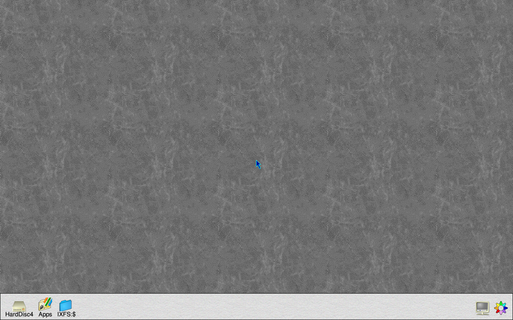

# RISC OS on Linux 1.0.0092 (27 November 2026)

RISC OS 5.31 (5.31-33: RISC OS Open's nightly in Timothy Baldwin's Linux
port) on Debian 13, for 64-bit ARM machines: Raspberry Pis, UEFI
machines and virtual machines, Apple Silicon Macs (UTM), the Windows
Dev Kit 2023 and the Pinebooks. RISC OS runs straight on the processor
where it can (Raspberry Pi 3, 4 and 5, the Dev Kit, the Pinebooks) and
under QEMU where it can't (Apple's processors).

New images with every update since [1.0.0058](1.0.0058.md) already in
them, with RISC3D 0.25 and printing installed. **Already running 1.0.0058
or 1.0.0020? Configure → Updates brings it to the same versions**,
without writing a card again (Updates installs printing on its first
run, and fetches the 3D drivers RISC3D uses).

This is a test release. Please [report](../README.md#reporting-a-problem)
what works and what doesn't.

## The images

| Image | For | File |
|---|---|---|
| Generic | Raspberry Pi 3/3B+/CM3, Zero 2 W, 4/400/CM4, 5/500/CM5; UEFI machines (QEMU, ARM boards and servers); Pinebook and Pinebook Pro | `riscos-generic.img.xz` |
| UTM | Apple Silicon Macs | `RISC OS 1.0.0092.utm` (in `RISC OS 1.0.0092.utm.zip`) |
| Windows Dev Kit 2023 | Snapdragon 8cx Gen 3 ("Project Volterra") only | `riscos-wdk2023.img.xz` |

Write the .img.xz to a card or USB disc with Raspberry Pi Imager ("Use
custom") or balenaEtcher. Unzip the .utm and double-click it to add it to
UTM. Each image starts straight into the RISC OS desktop; Shutdown powers
the machine off. `SHA256SUMS` lists the files' checksums. How to install
on each machine is in [the README](../README.md#installing).

The downloads are bigger than 1.0.0058's (about 280 MB, 255 MB and 520 MB, against 205, 180 and 361 MB): the difference is
printing (CUPS and Ghostscript) and the 3D drivers RISC3D draws with
(Debian's Mesa).

The Dev Kit image is only for the Dev Kit: anywhere else Linux finds no
screen and the machine switches off a minute later.

## New since 1.0.0058

The headlines:

- **Printing** through Linux's CUPS: Configure → Linux printing lists
  the printers on the network and USB printers that need no driver (most
  made since about 2012), with their settings and ink and toner levels;
  "Linux" in !Printers prints on the one chosen.
- **RISC3D 0.25**, 3D for programs built with riscos-mesa, drawn by
  Linux's Mesa (on the GPU where Linux has a driver for it); Configure →
  RISC3D.
- **USB joysticks and gamepads** with RISC OS's own joystick module.
- **The network:** Ping works; ShareFS and Freeway are in RISC OS;
  downloads are much faster; a name that briefly can't be found no
  longer becomes 127.0.0.1.
- **Sound** from a Raspberry Pi's HDMI screen; a USB sound adapter takes
  over when it's plugged in.
- **Discs:** NVMe drives in RISC OS's own format as on RISC OS itself;
  the FAT partition the machine starts from is `!Boot.Loader`; Dismount
  gives a USB stick or card in RISC OS's format back to Linux; a RISC OS
  Pi card written to a bigger card is RISC OS's.
- **Updates** updates itself first, no longer runs out of memory on a
  big update, and keeps Linux's own start-up safe (systemd is kept out).
- **Laptops:** a battery icon; dragging and two- and three-finger clicks
  on touchpads; Pinebook Pro Wi-Fi.
- **Programs:** RiscOSM starts; abort handlers can put the fault
  registers back (GCC 10 programs with a crash handler in front).
- **UTM and other VMs:** a smooth pointer.

Every update, newest first:

| Date | Package | What changed |
|---|---|---|
| 27 Nov | `riscos-support` 1.0.0092-1, `riscos-harddisc` 1.0.0080-1, `riscos-rom` 5.31-33 | From David Sharp: **Dismount gives a USB stick or card back to Linux** (safe to pull out; a Pi card's Loader appears); **a RISC OS Pi card on a bigger card is RISC OS's** (a 2 GB image on a 32 GB card); **abort handlers can put the fault registers back** (GCC 10 programs with a crash handler in front); **a file whose RISC OS type can't be read** is typed by its name instead of failing. |
| 27 Nov | `riscos-harddisc` 1.0.0081-1, `riscos-risc3d` 0.23-1 | **RISC3D 0.25** (PackMan's RISC3D 0.11.0.5-1, in place of 0.10.0.2-1): a program's 3D contexts last until it ends (one that runs a `*command` keeps them); Configure's RISC3D page shows the driver's version and can put the desktop's 2D on the GPU where the driver offers it; V3DRender 0.39 for RISC OS running on a Pi 4 itself (a growing buffer area for big games such as Doom 3). **RISC3D's Linux side 0.23-1** (rol-3d 0.20): contexts that share their objects, one per thread, for programs such as web browsers. |
| 26 Nov | `riscos-harddisc` 1.0.0078-1 | **Updates no longer runs out of memory on a big update** ("No room for function/procedure call"), as the first update from an older image could. If an older Updates stops like that, increase the WimpSlot in `!Boot.Resources.Configure.!ROLUpdate.!Run` (for example to 1024k), then use Updates again. |
| 26 Nov | `riscos-harddisc` 1.0.0079-1, `riscos-support` 1.0.0091-1 | **Updates updates itself first:** when Updates or the Linux side has a new version, Install updates installs those two first, starts the new Updates, and it installs the rest (no second password). **Printing is no longer removed** by an update where it came in as a recommendation of riscos-support 1.0.0088-1. |
| 25 Nov | `riscos-rom` 5.31-32 | **Ping works, and ShareFS is there:** RISC OS's Ping now gets its replies (it said "EPROTONOSUPPORT"), and other RISC OS machines' shared discs appear under the Discs icon, as on a Raspberry Pi; HardDisc4's folders can be shared with them. |
| 25 Nov | `riscos-support` 1.0.0085-1 | **USB joysticks and gamepads work with RISC OS's own USB joystick drivers**, unchanged, as on RISC OS itself; and a game controller no longer moves the pointer. |
| 25 Nov | `riscos-harddisc` 1.0.0073-1 | **RISC3D 0.10 and MesaLibs 20.3.5-23 come with it**, so programs using !MesaLibs (TORCS, ClassiCube) draw with the GPU on a new disc; and NetWatch and Battery start even when SparkFS loads at start-up. |
| 25 Nov | `riscos-support` 1.0.0086-1, `riscos-print` 1.0.0086-1 (new), `riscos-harddisc` 1.0.0074-1 | **Printing:** RISC OS prints through Linux's CUPS, on network printers that need no driver (IPP Everywhere, AirPrint: most made since about 2012) and USB printers that speak IPP over USB. Updates installs CUPS (about 70 MB) and puts "Linux" in !Printers (quit !Printers and run it again to see it); restart after the update. The new **Configure → Linux printing** chooses the printer, shows and changes its settings (paper size, quality, colour and so on), adds one by its address, and prints a test page. Tried under QEMU with a network printer; not yet with a real printer or on a Pi. |
| 25 Nov | `riscos-support` 1.0.0087-1 | **RISC OS on Linux keeps its own start-up.** Installing a Linux package that brings systemd would have replaced it, so the machine started Linux without RISC OS. apt now refuses, and says why, before anything is changed. If it's forced through anyway, ROL's start-up is put back at once, and the next start removes systemd and udev again. |
| 25 Nov | `riscos-support` 1.0.0088-1, `riscos-harddisc` 1.0.0075-1 | **A web address that briefly can't be found no longer turns into 127.0.0.1** (Iris stopped loading part of a page). ROL now gives RISC OS the network's domain name, as RISC OS's own DHCP does, so RISC OS's Resolver no longer falls back to "localhost" for a name it couldn't find. |
| 25 Nov | `riscos-support` 1.0.0089-1 | **Updates no longer tries to install systemd.** The update to 1.0.0088-1 stopped with "Errors were encountered while processing: systemd-sysv": printing's packages recommend colour management, which in Debian needs systemd. systemd can now never be installed, and printing is installed at the end of an update, without colour management. If your update stopped with that error, type `*Linux apt-get -y purge systemd libpam-systemd dbus-user-session libnss-systemd systemd-timesyncd systemd-cryptsetup` (it asks for the root password), then use Updates again. RISC OS still started normally after the error. |
| 25 Nov | `riscos-harddisc` 1.0.0076-1 | **ShareFS's Discs icon appears even when the network comes up after the desktop**, as it can on a Raspberry Pi 5 starting from NVMe, with a manual address or on Wi-Fi. ShareFS worked from the command line, but its icon and task were missing. |
| 25 Nov | `riscos-support` 1.0.0090-1, `riscos-print` 1.0.0090-1, `riscos-harddisc` 1.0.0077-1 | **Ink and toner levels** in Configure → Linux printing (Options...), for printers that report them, as most network printers do. **The printer you choose stays in CUPS's web pages**, rather than disappearing a minute after use. |
| 24 Nov | `riscos-kernel-pi` 6.6.78-18.2, `riscos-kernel-generic` 7.2.0-10.2, `riscos-kernel-wdk2023` 7.2.0-7.3 | **The running kernel keeps its drivers if a kernel update doesn't reach the boot partition**: its modules are kept until the machine restarts with the new kernel (a failed update had left the old kernel running without them, so drivers such as the Argon ONE UP's battery were lost). Repackaged, same files. |
| 24 Nov | `riscos-support` 1.0.0084-1 | **Sound from a Raspberry Pi's HDMI screen**: on a Pi, sound always went to the headphone socket, even with a screen with speakers. It now goes to the screen when the screen takes sound. To choose yourself, put `device=vc4hdmi0` (or `vc4hdmi1`, or `Headphones`) in `/riscos/sound/config`. Heard on a Pi 4 with the setting; the automatic choice is not yet tried on a Pi. |
| 24 Nov | `riscos-support` 1.0.0083-1 | The sound log now says how loud RISC OS's sound is and how the output's volume is set, to find where sound is lost. |
| 24 Nov | `riscos-rom` 5.31-31 | **Faster network downloads, over Ethernet and Wi-Fi.** Most RISC OS network programs set their own buffer sizes, and on Linux that held a download to a fraction of the line's speed (on a Pi 4 over Ethernet, 14 Mbit/s with 32 KB where Linux gets 160; Iris got 11). RISC OS now keeps those sizes for the program and lets Linux size the buffers. |
| 22 Nov | `riscos-support` 1.0.0082-1, `riscos-kernel-pi` 6.6.78-18.1, `riscos-kernel-generic` 7.2.0-10.1 | **Kernel updates no longer fill the boot partition** ("No space left on device"): one old copy of each kernel is kept, and the new one is swapped in by renaming. The kernel packages are repackaged to need this support version. |
| 20 Nov | `riscos-support` 1.0.0081-1 | **A smooth pointer in UTM while a program keeps RISC OS busy** (it went jerky with NetSurf running): in a VM with an absolute pointer, a mouse's moves now place the pointer at once rather than by way of RISC OS. Real mice on real machines are unchanged. Not yet tried in UTM. |
| 19 Nov | `riscos-kernel-pi` 6.6.78-18 | **HEVC frames can be cacheable**, so ReelHWAccel's HEVC decoder can convert pictures as fast as on native RISC OS (it was 3 to 4 times slower with uncached frames). Needs hevcdec 0.1.16. Not yet tried on a Pi 4 or 5. |
| 19 Nov | `riscos-support` 1.0.0079-1 | **PackMan comes back if it's missing**: when there's no !PackMan anywhere in HardDisc4, PackMan 0.9.8-1 is put back in Apps.Admin with its record, so it can upgrade itself as usual. One that has been moved is left alone. |
| 19 Nov | `riscos-support` 1.0.0080-1 | **The boot partition is checked and repaired at start-up**, so a machine switched off without shutting down no longer leaves updates failing with "Read-only file system". Brings in Debian's dosfstools. |
| 19 Nov | `riscos-kernel-generic` 7.2.0-10 | **Pinebook Pro Wi-Fi:** Linux now does the WPA2 handshake instead of the Wi-Fi chip's firmware, the usual workaround for its WPA2 problems. Not yet tried on a Pinebook Pro. |
| 18 Nov | `riscos-kernel-generic` 7.2.0-9 | **The Pinebook Pro's touchpad no longer gets stuck making every click Menu** (a finger the pad stopped reporting was kept as still touching). |
| 18 Nov | `riscos-support` 1.0.0074-1 | **A touchpad's two-finger click or tap is Adjust, three fingers Menu**, as on RISC OS itself on a Pinebook Pro. |
| 18 Nov | `riscos-kernel-wdk2023` 7.2.0-7.2 | **USB sound works on a Dev Kit with a DRAM-less NVMe drive** (the drive had taken all the memory USB sound needed). Restart after updating. |
| 18 Nov | `riscos-support` 1.0.0075-1 | **The sound's logs are in LOGS too**: which card RISC OS's sound plays on, and the sound cards Linux has. |
| 18 Nov | `riscos-support` 1.0.0076-1 | **A USB sound adapter plugged in takes over the sound at once**, and when it's unplugged the sound carries on through the next best output. |
| 18 Nov | `riscos-support` 1.0.0077-1, `riscos-harddisc` 1.0.0071-1 | **A USB disc in RISC OS's format with 4096-byte sectors gets a clear message** instead of SCSIFS's "Sector size not supported" (SCSIFS can't use such discs, on RISC OS itself too). |
| 18 Nov | `riscos-support` 1.0.0078-1 | **No more pause every second in 3D games** (the screen check no longer makes Linux re-read every display connector), and **a steadier pointer** while RISC OS is busy. |
| 18 Nov | `riscos-harddisc` 1.0.0072-1 | **The current directory is HardDisc4 after start-up**, as on RISC OS itself, so programs saving there (crash dumps, for one) work. |
| 18 Nov | `riscos-kernel-pi` 6.6.78-17 | **The Pi 4's, Pi 5's and CM5's HEVC (H.265) decoder is there for RISC OS** (Linux's rpivid driver, as `/dev/video*` and `/dev/media*`): the first step to hardware HEVC in ReelHWAccel under ROL. ReelHWAccel still needs a back end that uses it, so nothing plays HEVC through it yet. Not yet tried on a Pi 4 or 5. |
| 17 Nov | `riscos-support` 1.0.0071-1 | **Huawei mobile broadband sticks now switch to their network mode.** The message that does it had a byte too many, so sticks stayed CD drives. It is now the same message, sent the same way, as Linux distributions use (usb_modeswitch). Not yet tried with a stick. |
| 17 Nov | `riscos-harddisc` 1.0.0066-1 | **Start-up no longer stops at AArdvarkLoader** (a machine stuck in 640x480, or `*Linux` not found after removing it). A module that wouldn't load on a machine ended the start-up run there, skipping Configure, which sets the screen mode; now each module that fails is passed over and everything else carries on. The loader is now a plain file, `PreDesk.AArdvarkLoader`, which runs first, so Configure's sound settings are applied too. |
| 17 Nov | `riscos-support` 1.0.0072-1 | **RISC OS knows whether the machine's VideoCore can decode video for it** (`ROL$VideoCore`: 1 on a Pi 3 or 4, 0 elsewhere). |
| 17 Nov | `riscos-harddisc` 1.0.0067-1 | **The Pi's hardware video decoding is set up only on a Pi 3 or 4.** A Pi 5 or CM5, which has no H.264 decoder, no longer tries. Needs riscos-support 1.0.0072-1; before that, it is set up as before. |
| 17 Nov | `riscos-harddisc` 1.0.0068-1 | **RiscOSM starts** (it crashed with "Bad memory access"). The images had a cut-down character set converter (Iconv) where RISC OS Open's should be; the update puts RISC OS Open's Iconv 0.12 in its place. Restart afterwards. |
| 17 Nov | `riscos-harddisc` 1.0.0069-1 | **HardDisc4 can no longer be dismounted from its icon** (it is the disc RISC OS runs from); its menu has Open '$' and Free. |
| 17 Nov | `riscos-harddisc` 1.0.0070-1 | **Close windows** on HardDisc4's icon bar menu closes every window on HardDisc4's disc (IXFS), as Dismount does on RISC OS itself. Other discs' windows stay. |
| 17 Nov | `riscos-support` 1.0.0073-1 | **A smooth pointer in UTM and other VMs:** RISC OS's pointer is now the VM display's own cursor, which the host moves at once, instead of being drawn into the picture. |
| 17 Nov | `riscos-kernel-generic` 7.2.0-8 | **Pinebook Pro: the touchpad no longer gets stuck thinking two or three fingers are on it**, which turned clicks into Menu or Adjust and made one finger scroll. Not yet tried on a Pinebook Pro. |
| 16 Nov | `riscos-harddisc` 1.0.0058-1 | **RISC3D is included**, as a PackMan package (RISC3D 0.04-3 in `!Boot.Resources`): the 3D driver interface that lets programs drawing with OpenGL use the machine's graphics chip. PackMan keeps it up to date from now on. The Linux side that does the drawing is still the separate `riscos-risc3d` package; without it nothing changes. |
| 16 Nov | `riscos-kernel-wdk2023` 7.2.0-7.1, `riscos-support` 1.0.0069-1 | **The Windows Dev Kit 2023's GPU gets its firmware**, so RISC3D can draw with it. The two files it needs come from Debian's `firmware-qcom-soc`; only those two (about 100 KB) are kept on the Dev Kit, not the whole 305 MB package. The update downloads the package once (92 MB). Not yet tried on a Dev Kit. |
| 16 Nov | `riscos-support` 1.0.0068-1, `riscos-harddisc` 1.0.0064-1, `riscos-risc3d` 0.22-1 | **RISC3D comes with RISC OS on Linux: nothing to install** (new). RISC OS programs that draw with OpenGL (through riscos-mesa) can use the machine's GPU. Updates now installs RISC3D's Linux side (riscos-risc3d) by itself, then Mesa 25.2 from Debian's trixie-backports in its second pass, and RISC OS's side (!RISC3D, RISC3D 0.04-7) comes with riscos-harddisc, as a PackMan package. Restart after the update. Without it, programs draw in software as before. Not yet tried on a machine through Updates. |
| 16 Nov | `riscos-harddisc` 1.0.0063-1 | **A RISC OS-format disc with no icon since RISC OS 5.31-30** (George Greenfield), and possibly no sound or USB devices in RISC OS: the start-up file that loads RISC OS on Linux's own modules never ran if another file in `!Boot.Choices.Boot.PreDesk` earlier in the alphabet stopped with an error. They are now loaded by a new application there, `!AArdvarkLoader` (it has an aardvark for its icon), which runs even when one of those files fails; the list itself has moved to `Choices:Boot.TestBed`. |
| 16 Nov | `riscos-support` 1.0.0067-1 | **RISC OS no longer stops at start-up now and then with the hourglass showing.** About one start in 25 (under QEMU) stopped for good while the start-up files ran or as the desktop appeared. A clock tick arriving at just the wrong moment left RISC OS's clock switched off, and it then waited for ever. Fixed in NativeSupport 0.49. Tried with 60 starts in a row: 8 would have stopped, none did. |
| 16 Nov | `riscos-support` 1.0.0067-1 | **Raspberry Pi 5, 500 and Compute Module 5: an NVMe drive that stops answering after the machine has sat idle** (the battery icon goes, HardDisc4 gives "Disc Error"; andym's Argon ONE UP). Some NVMe drives don't come back from power saving on these machines, so the update turns NVMe and PCIe power saving off: it adds `nvme_core.default_ps_max_latency_us=0 pcie_aspm=off` to the end of `cmdline.txt` (in `!Boot.Loader`), once, keeping the file as it was as `cmdline.txt.old`. If you have set either yourself the file is left alone. Restart for it to take effect. |
| 16 Nov | `riscos-support` 1.0.0067-1, `riscos-harddisc` 1.0.0061-1 | **NVMe drives as on RISC OS itself** (new). An internal NVMe drive in RISC OS's own format is now an `NVMe::` drive, with RISC OS Open's NVMeFS and its own icon, where it was a `SCSI::` one; and a drive with **4K sectors**, which could not be used at all, is taken too. If you named the drive by its SCSI path anywhere, use its disc name or `NVMe::4` instead. Tried under emulation only, with 512 byte sectors and with a 512 GiB 4K drive formatted by RISCOSbits' formatter (files copied on and back identical, map good after a restart): **back up first**, and reports from real drives are very welcome. A blank NVMe drive can't be formatted from here yet. |
| 16 Nov | `riscos-support` 1.0.0067-1 | **The start-up (FAT) partition is `!Boot.Loader`**, as on a Raspberry Pi running RISC OS itself (new). The partition with the kernels, a Pi's `config.txt` and the LOGS folder can be opened from RISC OS: open HardDisc4, hold Shift and double-click `!Boot`, then open `Loader`. `config.txt` can be edited and the logs read without taking the card out. Take care there: the machine starts from those files. RISC OS's settings file (CMOS) now lives there too, as on a Pi; your settings carry over, and a copy of them as they were is kept beside it as `CMOS.bak` (refreshed at each later update). |
| 16 Nov | `riscos-support` 1.0.0067-1 | **Dragging with a laptop's touchpad.** Holding the pad down with one finger and moving another across it now drags (windows, files, scroll bars): it scrolled instead, or did nothing. Two fingers without pressing still scroll. Not yet tried on a real touchpad: reports welcome. |
| 15 Nov | `riscos-support` 1.0.0067-1 | **An internal RISC OS-format drive with 4K sectors** (some NVMe drives) no longer gets a hard disc icon that only says "Sector size not supported": RISC OS's SCSIFS can't use sectors over 1024 bytes, so such a drive is left alone for now. Reading them is to come. |
| 15 Nov | `riscos-support` 1.0.0067-1, `riscos-harddisc` 1.0.0057-1 | **A battery icon on the icon bar, on a machine with a battery** (new). It appears beside the display's icon when Linux reports a battery, and not otherwise: a battery that fills as it charges (amber when low, red when nearly out), with a flash over it on the mains, and the percentage under it. A click opens a small window with the charge as a bar, the state and the time left or the time to full. **Before the battery runs out RISC OS is shut down safely:** a warning at 10%, a shutdown at 5% in which programs with unsaved work ask first, and at 3% a shutdown without asking; then the machine turns off. It needs Linux to have a driver for the battery: the Pinebooks, and the Argon ONE UP with the kernel update below (none yet tried). |
| 15 Nov | `riscos-kernel-pi` 6.6.78-16 | **For laptops built round a Raspberry Pi 5 or Compute Module 5** (the Argon ONE UP). The Pi 5's I2C buses now exist (their driver was off), with `/dev/i2c-N` for programs that read a chip themselves; touchpads that speak HID multi-touch are driven as touchpads (without the driver the pointer jumped to wherever the finger landed); and **the Argon ONE UP's battery** is read, by Jeff Curless's driver, so the battery icon appears there. On an Argon ONE UP add to config.txt `dtparam=i2c_arm=on` above the first `dtoverlay=` line, and `dtoverlay=argon-oneup-battery`. Not yet tried on a Pi 5 or the Argon: reports welcome. |

## Versions in this release

| Package | Version |
|---|---|
| RISC OS (`riscos-rom`) | 5.31-33 |
| The Linux side (`riscos-support`) | 1.0.0092-1 |
| The desktop parts (`riscos-harddisc`) | 1.0.0081-1 (with PackMan's RISC3D 0.11.0.5-1, MesaLibs 20.3.5.0.23-1, Folio, NetSurf, RDPServer, CaCertificates) |
| Printing (`riscos-print`) | 1.0.0090-1, with Debian's CUPS 2.4.10 |
| RISC3D's Linux side (`riscos-risc3d`) | 0.23-1, with Debian's Mesa 26.1.6 from trixie-backports |
| Kernels | Pi 6.6.78-18.2 and generic 7.2.0-10.2 (generic image); Dev Kit 7.2.0-7.3 |
| Adapters' firmware | Debian's `firmware-realtek`, `firmware-mediatek`, `firmware-atheros`, `firmware-misc-nonfree`, `firmware-iwlwifi` 20250410-2, `firmware-ath9k-htc`, `firmware-carl9170` |
| Debian | 13 with its updates to 27 November 2026 |

## Tested

| Machine | |
|---|---|
| QEMU, as a UEFI machine | this release's generic image, started from the image by UEFI firmware: the desktop; RISC3D with Linux3D registered; rol-3d, CUPS, avahi and the printing helper running |
| QEMU, as a UEFI machine with UTM's disc | this release's UTM disc (qcow2) started by UEFI firmware: the desktop |
| Raspberry Pi 3, 4, 5, Compute Modules | these kernels are the ones Updates has delivered since 24 November |
| Windows Dev Kit 2023 | not confirmed (it can't be emulated): the image is built the same way |
| Pinebook, Pinebook Pro | untried: treat as experimental |

Thank you to David Sharp, David Pitt, Chris Gransden, Chris Hughes,
George Greenfield, Chris Hall, Raik, Ralph Barrett and Norman Lawrence
for their testing and reports.

## Known issues

- On a Raspberry Pi, ROBench's BPut/BGet tests fail to open their file.
- Wi-Fi has been reported slow on a Raspberry Pi 4 (a few megabits a
  second): being looked into; the band and signal strength help.
- Debian's firmware (April 2025) is older than the generic kernel, so
  the very newest Wi-Fi chips may lack firmware.
- Iris isn't included: install it with PackMan (riscosdev.com's list is
  already set up).

Please send reports with the `LOGS` folder from the FAT partition.

## The full history

[1.0.0058's notes](1.0.0058.md) and [1.0.0020's](1.0.0020.md#the-full-history)
have the history before this; the table above carries on from 1.0.0058,
and [riscos-rolpkg's CHANGELOG](https://github.com/adyoull/riscos-rolpkg/blob/main/CHANGELOG.md)
has every package version.

## Source and licences

As [1.0.0058](1.0.0058.md#source-and-licences). New here: Debian's CUPS,
Ghostscript and Mesa packages, unchanged, each under its own licence
(`/usr/share/doc/*/copyright` on the image's Linux partition); RISC3D is
MIT, and V3DRender, in !RISC3D's GPU folder, is GPL-2 (its source is
linked from !RISC3D.GPU.Licences).
