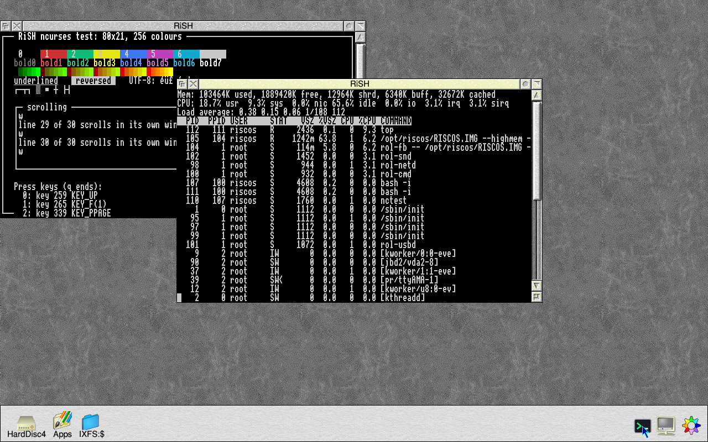
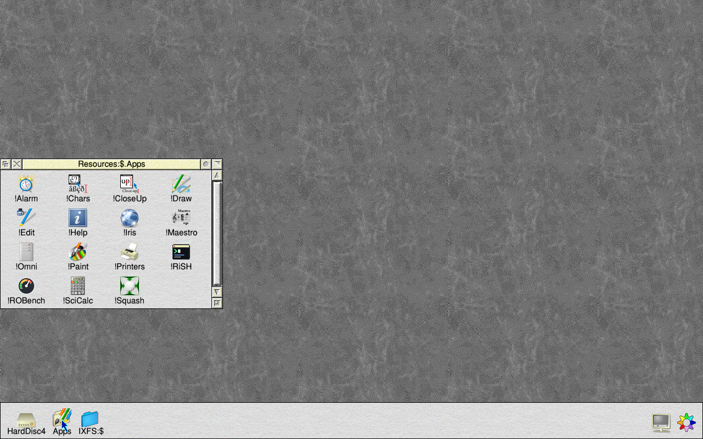
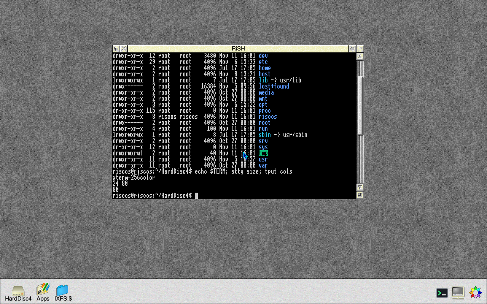
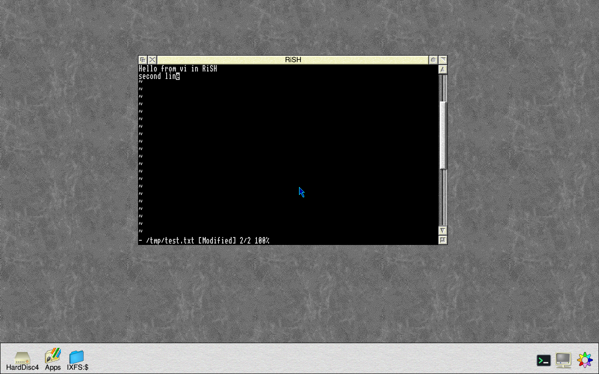
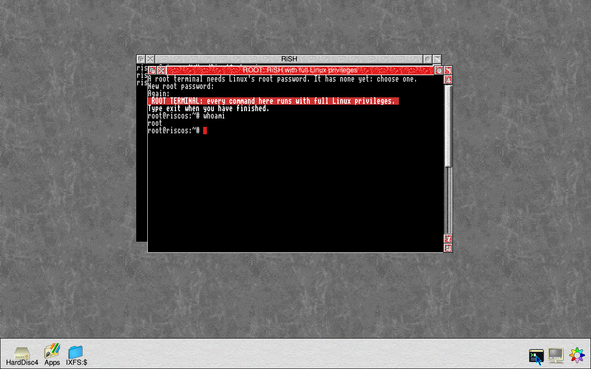
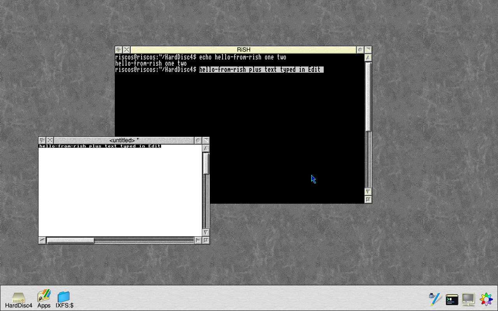
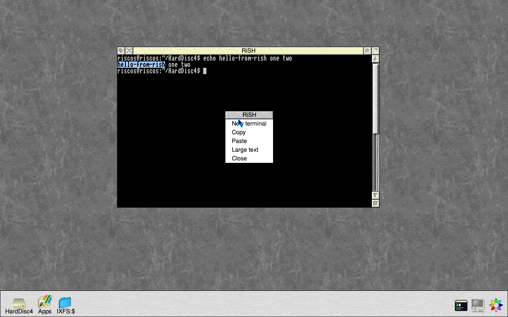
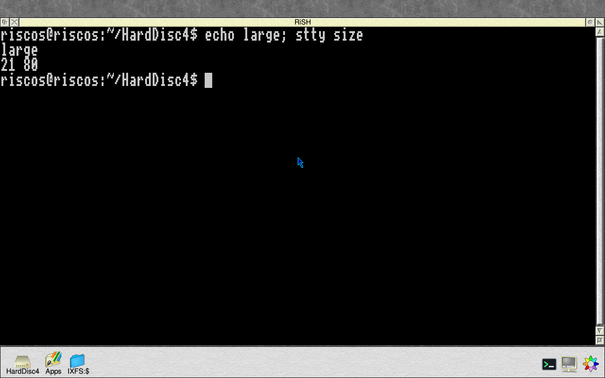

# RiSH 0.03, the RISC Shell (11 November 2026)

RiSH is a Linux terminal for the RISC OS desktop, for RISC OS on Linux.
Each window is a Linux shell, and full-screen Linux programs run in it.
This is its first release.

## Getting it

RiSH comes through **Configure → Updates** on RISC OS on Linux 1.0.0020
(`riscos-harddisc` 1.0.0049-1, with `riscos-support` 1.0.0044-1, which it
needs). Afterwards it is in **Apps**. There is nothing to download from
this page: RiSH needs the Linux side that arrives with it, so it doesn't
work copied in on its own, and it doesn't run on other RISC OS machines.

## What it does

- **A terminal:** double-click !RiSH. The window is a Linux shell as RISC
  OS's own Linux user (the one `*IXRun` uses): type Linux commands
  straight in. `exit`, or closing the window, ends it. Select on the icon
  bar icon opens another; up to six at once.

  

- **Full-screen programs:** editors, pagers, `top`, and anything else
  written for an xterm, with 256 colours, line drawing, bold, underline
  and reverse. The images have few such programs installed: in a root
  terminal, `apt-get install nano` (or `vim`, `htop`, `less`).

  

- **A root terminal:** **Root shell** on the icon bar menu, or Adjust on
  the icon. It asks for Linux's root password first (the one `*Linux` and
  Updates use). It can't be mistaken for an ordinary terminal: a red title
  bar beginning "ROOT:", a red cursor, and a line in bold at the top.
  `su` and `sudo` don't work in the ordinary terminal.

  

- **Copy and paste:** drag with Select to select text (Adjust moves the
  end of the selection). **Copy** on the menu, or Ctrl-Shift-C, puts it on
  RISC OS's clipboard; **Paste**, Ctrl-Shift-V or Shift-Insert types the
  clipboard's text in. It works with other RISC OS programs in both
  directions. Ctrl-C and Ctrl-V alone go to Linux.

  

  

- **The window:** resize it and the program inside is told. The scroll bar
  shows the last 1000 lines that scrolled off the top. **Large text**
  doubles the text size, for 4K screens (it is on to begin with on a
  screen 2560 pixels wide or more). The title is the program's.

  

- **Keys:** everything goes to Linux except F12 and the other keys RISC OS
  keeps. The cursor keys, Home, Copy (End), Page Up and Down, Insert,
  Delete, Tab and F1 to F11 are what an xterm sends.

## Not yet

- The mouse inside programs.
- Italic and blinking text.
- Characters RISC OS's system font doesn't have show as "?".

## Tested

Under QEMU (RISC OS 5.31-24, 1280 x 800): the shell, `ls --color`, vi,
less and top (busybox's), an ncurses test program, resizing, the scroll
bar, Large text, two terminals, the root terminal, and copy and paste
both ways with !Edit. **Not yet tested on a Raspberry Pi or a 4K screen,
or with nano itself:** reports welcome, with the `LOGS` folder if
something goes wrong.

## Versions

| Version | Date | What changed |
|---|---|---|
| 0.04 | 11 Nov 2026 | Other programs' text in the system font (Edit's, say) is no longer drawn half height after a RiSH window has redrawn: RiSH puts the font's size back as it found it (riscos-harddisc 1.0.0049-1) |
| 0.03 | 11 Nov 2026 | Copy and paste |
| 0.02 | 11 Nov 2026 | Its full name, the RISC Shell, in Info and !Help |
| 0.01 | 11 Nov 2026 | The first version: terminals, full-screen programs, the root terminal, resizing, scrollback, Large text |

## Source and licence

RiSH is part of RISC OS on Linux. Copyright (c) 2026 Andrew Youll, MIT
licence (the file `LICENSE` in the application, from riscos-harddisc
1.0.0048-1). The program is linked with UnixLib, whose licences are in
`UnixLib-COPYING` beside it. Its Linux side is rol-cmd, in
`riscos-support`.
